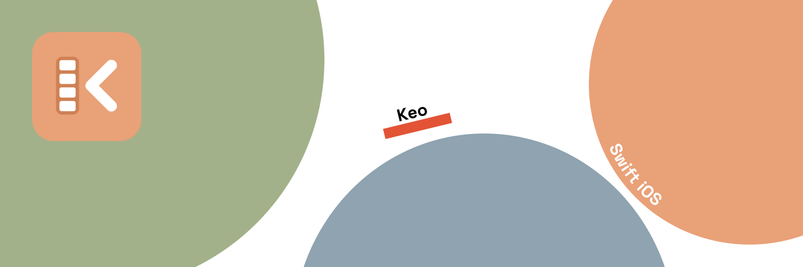

# Keo



Native iOS photo/video gallery for Freebox, through the Freebox OS API.
SwiftUI, Swift 6 with strict concurrency, no external dependencies.

This file explains **why** the code is the way it is. `CLAUDE.md` says **what applies**: the
read-only rule, the check command, the conventions, and the traps that have already cost
dearly.

## Non-negotiable rule

**Keo never modifies anything on the NAS.** No moving, no renaming, no deleting, no writing.
This is not an intention, it is a structural constraint:

- `ReadOnlyTransport` is the only door to the NAS and exposes nothing but reads. No HTTP
  method parameter, no request body. Writing would require adding a method to that type.
- The login handshake, the only place that does a `POST`, lives in `LoginTransport`, out of
  reach of the data path.
- `Tests/main.swift` reads the sources back and fails if a `PUT`/`DELETE`/`PATCH`/`MOVE`/
  `MKCOL`/`COPY` or an `fs/mv`, `fs/rm`, `fs/rename`, `fs/mkdir`… route appears anywhere
  other than in a comment. The widget extension is read back too.

## Running it

```sh
open Keo.xcodeproj     # ⌘R
```

On first launch: "Associer à la Freebox" (pair with the Freebox), then **press ✓ on the front
of the Freebox Server**. The app token goes into the iOS Keychain.

If browsing returns a permissions error: Freebox OS → Settings → Access management →
Applications → Keo → tick "File access".

## One pairing for all your devices

The app token is marked `kSecAttrSynchronizable`: the **iCloud Keychain** carries it from one
device to the next. A second phone signed in to the same Apple account installs Keo, opens it,
and finds itself paired without anyone touching the box.

**Nothing to do with the personalisation sync further down.** That one is a CloudKit mirror
the app drives; the Keychain is a system service the app merely hands an item to. Two
mechanisms, two switches in Settings, no dependency between them: Keychain off still lets
favourites sync, and the reverse holds too.

The trade-off, accepted: the Freebox sees **only one authorisation**, shared. No way to revoke
one without revoking the others. The pairing screen says so in one line, because a shared
authorisation you believe is individual is a nasty surprise the day you want to pull access
from a lost device.

Nothing to configure: no capability to tick, no entitlement to add; the default keychain group
is enough. The switch already exists on the system side (Settings → account → iCloud →
Passwords), and turning it off brings back exactly the previous behaviour: a local token, one
pairing per device.

### What is delicate, and what the code does

- **`Synchronizable` is part of an item's primary key.** A query that omits it sees only
  local items; a query that sets it to `true` sees only synchronised ones. And an item does
  not convert in place. Every `Keychain` query therefore goes through
  `kSecAttrSynchronizableAny`: a single read, a single delete, which find the token whatever
  its nature. No caller changed.
- **Migration of tokens already stored** happens on read, the one place everyone already goes
  through. If the item found is not synchronisable, it is rewritten. It is idempotent: a
  token already migrated is read and left alone.
- **The write order is the no-loss guarantee.** The synchronised item is updated in place
  (`SecItemUpdate`), added only if it does not exist, and the local one is deleted
  **only after** a success. iOS does not say whether iCloud Keychain is active; a failure, an
  offline device or a missing Apple account therefore cost nothing, the token stays readable
  and the attempt repeats on the next launch. Losing the token would cost a trip to the box,
  which is precisely the bug already lived through once.

  This paragraph long described an intention rather than the code: `set` began with a
  `SecItemDelete` of the synchronisable predecessor, *before* the add. A refused `SecItemAdd`
  therefore destroyed the only copy that travels through iCloud, exactly the loss the
  paragraph promised to avoid. The source scan in `Tests/sync.swift` now forbids the
  regression: it requires `SecItemUpdate`, and that no `SecItemDelete` precede the write.
- **`kSecAttrAccessibleAfterFirstUnlock` is kept.** The `…ThisDeviceOnly` classes are refused
  for a synchronisable item, and refused **silently**. `AfterFirstUnlock` is the strictest
  class that still synchronises, and it is the one needed so that a download resumed in the
  background after a reboot can read the token.
- **Signing out erases both natures**, always through `Any`. Without that, the local item
  would survive the deletion of the synchronised one and the token would come back from the
  dead on the next launch.
- **The token sometimes takes a few seconds to arrive** on a device that has just joined the
  keychain. The pairing screen therefore waits up to fifteen seconds before giving up, without
  ever blocking the button: a tap on it ends the wait.
- **The token is the only thing stored in the Keychain**; `Keychain.set/get/delete` is never
  called with any account other than the box's host. The question "what else to synchronise"
  therefore does not arise; the day it does, it will arise per secret, not wholesale: sharing
  is justified here because the authorisation belongs to the household, not to the device.

### Checking by hand

The source scan in `Tests/main.swift` forbids the two regressions that fail silently (a
`ThisDeviceOnly` class, a query without `Synchronizable`). The rest requires two devices and a
real iCloud Keychain:

- **Migration**: on a device already paired by the previous version, install this one and
  launch. The gallery opens directly, with no pairing screen and **no press on ✓**. The token
  was rewritten silently.
- **Second device, same Apple account**: install Keo, launch. The pairing screen appears, then
  switches to the gallery by itself within a few seconds, box never touched.
- **iCloud Keychain off** (Settings → account → iCloud → Passwords): the device already
  paired stays paired, the gallery opens as before. A new device, though, asks for the press
  on ✓: the previous behaviour, not a failure.
- **Offline**: airplane mode, uninstall, reinstall, launch. With the local token gone with the
  app and the keychain unable to deliver anything, the pairing screen shows without spinning
  in circles. Network back, relaunch: the gallery opens on its own.
- **Second Apple account**: on the device signed in with the other account, the token does not
  arrive. Pair normally, and check that this second pairing does not break the first (the box
  does allow two apps with the same name, they have distinct tokens).
- **Sign out then relaunch**: "Déconnecter" (sign out) on device A, kill the app, relaunch:
  the pairing screen stays, the token does not come back. Then relaunch device B: it asks for
  pairing again too, which is the trade-off, not a bug.
- **Revocation on the box side**: Freebox OS → Access management → remove Keo. On the next
  launch, validation by listing fails, the token is erased in both natures and normal pairing
  resumes, without looping.

## Build number

`Scripts/stamp-build.sh` stamps the **built** `Info.plist`, never the one in the repo, during
a build phase:

- `CFBundleVersion` = number of commits, so it goes up with every commit, no manual entry
- `KeoCommit` = short hash, suffixed with a `+` if the build carried uncommitted changes

Shown small at the bottom of the pairing screen, in the form `v0.1 (13) · a1b2c3d`.

**No longer on Home.** It is support information, looked at twice a year, and it took up a
permanent line on the one page the owner opens every day. It sits behind **ten taps on the
Keo logo** at the top of Home, appears under the logotype and closes by itself after eight
seconds: a hatch, not a box to untick. The count resets to zero as soon as a tap is more than
a second and a half late: otherwise ten absent-minded presses spread over a week would end up
opening it, and a hatch that opens on its own is a bug.

It stays visible on the pairing screen, because that is the screen you are on when nothing
works yet and there is no Home to tap.

Without git (building from an archive), the script exits without doing anything and the
repo's value is kept.

The phase is mounted **on both targets**, Keo and KeoWidgetExtension. The script works on
`$TARGET_BUILD_DIR/$INFOPLIST_PATH`, so it stamps the bundle of whichever target runs it,
changing nothing else. Do not remove it from either: **iOS refuses to install an app whose
extension does not carry the same `CFBundleVersion` as the host**, and the app would ship as
build 42 with an `.appex` still at 1. The failure is at install time, not at compile time.

## Identity

Mascot and logos come from `../keo assets`. Only what is used is copied into
`Keo/Assets.xcassets`:

- **`AppIcon`** ← generated by `Design/icon/build.py` from the master SVGs, in three
  appearances (light, dark, tinted). An iOS icon cannot have an alpha channel, so the cut-out
  variant does not fit here. The same script outputs `MarkGlyph.imageset` from
  `keo-glyph.svg`: the mark redrawn for the size of a tab. See `Design/icon/README.md`,
  which is the reference for everything that touches the icon.
- **`AccentColor`** ← `#e9a178`, the brand's peach, **a single value for both
  appearances**. It tints the whole app: buttons, folders, the timeline rail.

  Worth knowing before touching it: this peach gives **2.14:1 on white**, below the 3.0
  threshold that applies even to an icon. It is a brand choice the owner stands behind, not
  an oversight. It has a consequence no `grep` shows: iOS paints **every unstyled `Button`**
  in the tint, "Plus tard" (later), bar buttons, alert buttons, and in the light appearance
  they are therefore faint. Whatever genuinely carries information is doubled elsewhere: a
  gauge has its figures above it, an icon has its label beside it, a warning has its symbol.
- **`OnAccent`** ← `#1C1C1E`, also a single value. It is the ink laid **on** the tint: the
  label of a prominent button, an active filter chip, a selection tick. SwiftUI would
  otherwise pick white, assuming a dark fill; on the peach that drops to 2.14:1. Here: 7.97:1.
- **`ChartPhotos` / `ChartVideos`** do not follow the brand, and that is deliberate: they are
  categorical data colours, which must be told apart from each other **and** hold up on the
  background. They went through a validator (lightness band, chroma floor, colour-blind
  separation, contrast) in light and in dark. Repainting them peach would make the chart
  unreadable.

## The app spoke English without knowing it

`CFBundleDevelopmentRegion` was `en` and no French localisation was declared.
`Locale.current` therefore resolved to English **whatever the iPhone's setting**: every date
the app formatted came out in English, "August 2011" under an entirely French interface.
Visible only where a month is spelled out in full, so it stayed invisible for months.

The bundle now declares `fr`, in the app as in the widget extension.

## Home

Opening Keo landed in a folder listing titled with a hostname. That listing is the best
folder browser a Freebox will ever have, fifteen years of someone's organisation, but it was
never a home. It stays, one tab over.

**The principle, and it is the one holding the whole redesign together: the soul does not go
in the chrome.** Apple's two warmest apps, Journal and Fitness, have rigorously standard
chrome. The warmth comes from elsewhere: from the person's content, from the language, and
from a single character strictly rationed. System skeleton, personal flesh.

Home shows, in order: **Ce jour-là** (On this day: the photos taken on this date in past
years, one page per year, the text laid on the gradient of the photo itself, the user's own
colour, without a line of palette extraction), the **pinned folders**, the **latest photos
by capture date** (which no NAS gallery does honestly: Plex and Jellyfin sort by import date,
which on a NAS is the copy date, precisely the lie this index exists to correct), and the
**Bibliothèque** (Library) card.

Everything comes out of the local index: five queries, not the dozen of `statistics`, because
this screen opens on every launch. The box can stay off all day without Home so much as
blinking, which is the point, since it sits on the home network and the phone is not on it
two thirds of the time.

### The Pinned tab goes away

A pin is an **accelerator, not a destination**, and parking an accelerator in a destination
slot is exactly what made that tab ring false; its content was only ever a list of paths,
there was never the idea of a screen in it. Pins become Home's shelf, *above the fold*, so
strictly more reachable than before.

### The machinery has a room of its own

Indexing, Statistics and Sign out lived in the sort menu of every folder. Machinery visible
everywhere is the disease that makes Immich look like an admin console. They are in the
Library card, where the indexing state is **permanently visible** rather than something to
rediscover. The contextual surfaces stay, because the context justifies them: the badges, and
the search button.

### Appearance follows the system

The app forced dark mode. Defensible for a gallery, Lightroom does the same, but Lightroom's
argument is a **calibration** argument: a neutral surround for judging the colours you are
correcting. Looking at family photos is not that, and a black surface at noon in the kitchen
is a cinema, not a home. The brand had already voted anyway: `AccentColor` ships a light
variant that had never once been rendered.

**The viewer stays black**, pinned on itself and not at the app's root: a photo is looked at
on black whatever the light in the room, and that is what Photos does.

What had to change: the timeline rail painted in `.white` on a background assumed black, it
paints in `.primary`; the mascot, cream on white, would be invisible, so it became a
*template* image that receives its colour instead of carrying it. (The mascot has since gone:
see below.) The remaining whites are all laid **on photos**, where they are right in both
modes.

### The mascot, and why it is no longer there

The 3D-rendered otter never made it into the app: photorealistic fur next to SF Symbols and
liquid glass reads like the title screen of a free-to-play game, and it would date within two
years. It stays on the icon, and nowhere else.

The flat cream silhouette, for its part, lived in three "the app has nothing of yours to show
yet" screens: pairing, the welcome card, indexing never started. It left with them. What
replaces it is not another drawing but **less drawing**: those screens say what they are
waiting for, in text, and the brand now appears only on the icon and on the Home tab
(`MarkGlyph`, the cage redrawn for 30 pt). A mascot that appears only where the app is empty
is a mascot you associate with emptiness.

## Structure

| Folder | Role |
|---|---|
| `Keo/App/` | Entry point, `Store` (session, pairing), Keychain, build stamp |
| `Keo/Freebox/` | `Item` and `FolderContents`, transports, client, authenticated video asset |
| `Keo/Media/` | Thumbnail pipeline, ImageIO decoding, LRU disk cache, date index |
| `Keo/Downloads/` | Queue, camera roll, share sheet |
| `Keo/Sync/` | CloudKit mirror of personalisation: record identity, engine |
| `Keo/UI/` | Home, pairing, grid, search, statistics, viewer |
| `KeoWidget/` | The WidgetKit extension. Links only Foundation, SwiftUI, ImageIO and AppIntents |

Dependencies point inwards: `UI` → `Media`/`Downloads` → `Freebox`. Nothing in `Freebox`
knows about SwiftUI.

Splitting into SPM packages was deliberately deferred: at this size it would add ceremony
without reducing complexity. The boundaries are already in place to do it the day several
people work on it in parallel.

## The date shown in full screen

The name and the date appear at the top, in a translucent capsule.

The date comes from the **EXIF** (`DateTimeOriginal`) when the file carries it, readable for
free, since the viewer already downloads the original. For videos, it is the asset's
`creationDate`. Failing that, the modification date is shown **prefixed with "Modifié le"**
(modified on): a copy date must never pass for a capture date. With no date at all, nothing
is shown rather than an invented date.

It is also the answer to the sorting limit: in full screen, the real date is known. The grid,
though, cannot sort on it without downloading a piece of every file.

## The copy date stays out of the timeline

`timelineDate` fell back to `modified` when the capture date was missing. On a NAS, `modified`
is the **copy** date: an undated photo therefore carried a recent date and rose to the top of
the "plus récentes" (newest) sort, above photos actually taken yesterday.

And it was inconsistent depending on the path. A fresh listing from the box carries that
mtime, a re-read from the index does not; the same photo changed place depending on who
painted the grid.

The timeline now looks only at the capture date. The modification date stays available and is
still stated honestly where it means something, under the photo in full screen ("Modifié
le"). An undated photo belongs in "sans date" (undated), not at the top of a chronology under
a date on which nobody took it.

## Real dates rather than copy dates

On a NAS, the modification date is often the day everything was copied: every file then
carries the same one, and sorting or grouping by date yields nothing. So Keo reads the real
capture date.

How many bytes does it take? Measured on **120 photos drawn at random from a real photo
library**, not on files made up for the occasion:

| First tier | Dates found | Requests/photo | Average transfer |
|---|---|---|---|
| 4 KB | 38.9% | 1.63 | 85 KB |
| 16 KB | 92.0% | 1.13 | 33 KB |
| **24 KB** | **99.1%** | **1.07** | **33 KB** |
| 128 KB | 100% | 1.06 | 135 KB |

So Keo reads **24 KB**, then 128 KB for the last percent. No photo in the sample revealed its
date only in the full file: what 128 KB does not find does not exist. In this sample, 6% of
photos genuinely have no date: web exports, received images, screenshots.

**`readerVersion`**: when this reader improves, every photo still without a date is queued
again. A date already found is never discarded. Without that, the 61% missed by the 4 KB
tier would have stayed wrong forever.

Beware the HEIC trap: the source must be a `CGImageSourceCreateWithData`, because in
non-finalised incremental mode ImageIO refuses to parse HEIF metadata and returns nothing,
however many bytes it is given.

- When a folder is opened, the dates already known are applied **before the first render**.
- Files never seen before are read in the background, `Indexer.parallel` at a time (**4**,
  measured, see "Read benchmark") and 24 KB each. A folder of 10,000 photos therefore costs
  about 240 MB of reads, **once**.
- The thumbnail pipeline records the date on the way through: it already downloads 256 KB
  per image, so the read is free. But it is not allowed to **erase** one: its `note()` passes
  `preservingCapture`, which switches the `DO UPDATE` to `coalesce(excluded.capture, …)`.
  Without that, a decode that found no date replaced the one the indexer had read with NULL,
  and marked the row `read = 1`, so nobody ever read it again. The `coalesce` cannot be
  global: the indexer, for its part, must keep the right to write NULL, because "read, no
  EXIF date" is a verdict and not ignorance. It is the same distinction as everywhere else in
  this file, one level up.
- `IndexStore` persists everything in Application Support, including files **without** a
  date; otherwise every visit would analyse them again indefinitely.
- Reordering happens **only at the end of the scan**, not during it: the grid never
  rearranges itself under your finger. Progress shows on the outline of the tab bar
  (`TabBarGlow`) and in the "Indexation" row on Home.

### 6.9% undated: measure before fixing

The 120-photo sample promised ~1% genuinely undated; the whole library shows **1,584 of
23,073** (6.9%), read end to end. A sample from a single folder was not the library; the
lesson is already written above, and it repeats.

Before touching the reader, a probe, `ReadBench.dateless` (since removed: its answer is
below), drew at random from the very list the Statistics screen counts and asked each file
*why*: for a photo, it climbs the indexer's exact ladder again (24 KB then 128 KB; a date
found there is marked `(!)`, the index should have had it), then two rungs the indexer does
not have (512 KB, then the whole file under 8 MB); for a video, it replays the atom parser.
The whole thing is aggregated **by extension and by verdict** in `[keo] sansdate:`, because
the hypotheses to settle can be read straight off it: EXIF beyond 128 KB, formats without
EXIF (PNG, screenshots, exports), a bug in the second attempt, or videos dominating the count.

The last line counts what a fallback on the **filename** would recover (`FilenameDate`, pure
and tested: `IMG_20190714_103000`, WhatsApp, screenshots, Pixel, and the traps rejected:
counters, 30 February, the future). It is **another truth** than the capture date, a label
put there by a device, not a shutter, and it will never be silently mixed with a real date.
Today only the benchmark consumes it; wiring it into the index, widening a window, or
concluding that N files genuinely have no date and saying so as is: the decision waits for
the benchmark's verdict, not for a hunch.

### The index: SQLite, incremental and durable

`Keo/Media/IndexStore.swift`: an actor owning a SQLite connection in WAL mode, in Application
Support. `libsqlite3` ships with iOS, so still no external dependency.

The previous version was a JSON dictionary loaded whole into memory and **rewritten in full**
on every save. The problem was not the size but the granularity: the unit of writing was
"the whole index" and the unit of loss "everything since the last save". A kill in the middle
of a folder of 14,600 photos threw away six minutes of work.

```sql
folder(id, path UNIQUE, mtime, child_count, media_count, bytes, gen)
file(folder_id, name, size, capture, read, kind, gen)  PRIMARY KEY (folder_id, name, size)
INDEX file_by_identity ON file(name, size)
meta(k, v)
```

| Guarantee | How |
|---|---|
| Durable at every instant | WAL + `synchronous = NORMAL`. A kill, a crash or a flat battery corrupts nothing |
| Bounded loss | One transaction every 256 files: at worst 256 reads to redo, not a whole folder |
| Consistent marking | The "folder finished" mark goes in **the same transaction** as its last batch; it can never claim more than what is written |
| Memory | Nothing is loaded at startup any more; one query per folder opened |
| Free renames | `file_by_identity` finds the date of a moved file by `(name, size)`. Renaming a folder of 14,600 photos used to cost hours of rereading; it is now a few milliseconds |
| No bloat | Generation counter: whatever was not seen again in the listing is deleted, subtrees by cascade |
| Skipped subtrees | An untouched folder is not listed, but its whole subtree sees its generation advance; otherwise the sweep would erase it |

The key `(folder, name, size)` replaces `"path|size"`: the old one repeated 456 KB of path
prefix on the one big folder alone.

**Migration**: the old `capture-dates.json` and `indexed-folders.json` are taken over on
first launch, then deleted. Indexing already paid for is not paid for again; that is checked.

### The first time

As long as the index is empty, Keo explains once why indexing matters: without it, the NAS
only provides the copy date, so sorting by date and the timeline stay inert, and the app
looks broken rather than unconfigured. The screen offers to start or to put it off; in that
case the badge and the menu are enough, it does not ask again.

### Keo forgot nothing, except what it had just done

The summary of a walk lived eight seconds in a floating card, the reader set it back to
`nil`, and the trouble (unreachable folders, unreadable files, folders set aside by the rule)
lived only in `Progress`, so for the duration of the walk and not a second longer. Everything
the app knew about its indexing therefore covered the five per cent of the time a walk is
running. The rest of the time, only totals remained, and a total answers no question.

`LastPass` is what the pass leaves behind: the `WalkSummary`, its date, the trouble counters
and the first paths in detail. It is stored in the index's `meta` table and not in settings,
**because it describes the index**: "Tout relire depuis zéro" (reread everything from
scratch) takes it away in the same transaction as the dates it summarises. A record written
by an older version that no longer reads back is simply absent; a missing summary is one
sentence fewer, and refusing to open the screen for that would be worse.

What it unlocks, which is the real subject: the Indexation screen finally has something to
say when nothing is running, and the Home row can speak of failures and freshness instead of
a folder report.

#### But it remembered too well

Keeping the summary revealed the reverse of the original bug. Four counters (`datesRead`,
`dateless`, `adopted`, `unreadable`) were not reset between two passes of the same session.
Accumulating is **right** for a resume: an interrupted pass that starts again skips the
folders already finished instead of rereading them, so its counters must carry on. It is
**wrong** for a fresh pass launched after a `finished` one: "N dates lues" then announced
the sum of two walks, and `LastPass.hasTrouble`, which only looks at `unreadable > 0`,
stayed true until the end of time after a single unreadable file, long after the cause had
gone. A warning light that never goes out is a warning light nobody reads any more. The
starting progress is therefore chosen on the state: `.paused`/`.running` carries on,
`.idle`/`.finished` starts from zero.

Two other lies from the same screen went with it:

- **"Interrompue" on a healthy index.** Opening a non-indexed folder starts a targeted scan
  without a walk; the end of such a pass had no `walkCompleted`, so it set `.paused`, so
  Home displayed "Interrompue · reste N" in amber when nothing had been interrupted. The
  right distinction is `resumeWanted`, which only a real pass sets; without it, the end of a
  targeted scan falls back to `.idle` and the row says "N fichiers à lire", in black, which
  is exactly what happened.
- **A superseded worker was deciding.** The `token == runToken` guard in `finishRun` sat
  below the publication of the summary and below the clearing of `summary`/`record`: a stale
  worker could empty the report a fresh worker was in the middle of building. It has moved
  to the top. `walkCompleted = true` still exists in only one place in the project; that is
  the criterion for rereading this file, and it can be checked with a `grep`.

### "X folders of Y" said nothing

The "Indexation" row on Home announced `4 781 dossiers sur 4 802`. Wrong answer twice over:
the subtraction is left to the reader, and the branch almost never shows, because periodic
discovery stamps every folder it lists, so folders are up to date long before files are. A
folder report is the machinery talking about itself.

`IndexingLine` replaces it with an **order of priority**, not a formula: at any moment only
one thing deserves the line, and the rarest is the most precious.

1. a walk in progress, with a figure that moves: `En cours · 412 dates lues`. No ellipsis: an
   ellipsis proves a flag is raised, a counter proves work, and that is exactly the
   distinction `isStalled` exists to make;
2. `Interrompue · reste 340`, in amber: the only state waiting for a gesture;
3. `3 dossiers inaccessibles`, in amber: an unmounted share lets the index rot in silence,
   and nothing else on Home would ever mention it;
4. `340 fichiers à lire`, **without** amber: periodic discovery produces these on its own
   every time photos arrive, and colouring the normal course of things teaches you to ignore
   the colour;
5. `Vérifié hier`, otherwise. The daily question is not "how many?" but "can I trust what I
   am looking at". Machine register, so the system's relative style and above all not
   `HumanDate`: "Un mardi de juillet" (a Tuesday in July) for a walk over a NAS would be
   absurd.

The order is checked in `Tests/indexation.swift`, not the formatting: the order is what is
easy to break and impossible to see.

### The Indexation screen, rebuilt

Four sections instead of three, and above all content at the right moment.

- **Maintenant** (now): during the walk, the folder under the needle and its bar; the rest
  of the time, the last pass told. The ten lines of counters were a dump of the `Progress`
  struct: per-pass and global mixed, zeros spelled out, and two of them repeated what the
  bar already said. They now go through `WalkSummary.details`, which already decides what to
  say and in what order; the walk and its summary speak with one voice.
- **À surveiller** (to watch): unreachable, unreadable, technical folders set aside, each
  opening the list of paths. Absent when there is nothing to say. They could only be read
  while walking, which is the opposite of the need: a vanished share deserves to be known
  precisely when nothing is running.
- **Action**: one main gesture and "Revérifier". "Tout relire depuis zéro" goes into the "…"
  menu of the bar: three lines of equal rank was the screen claiming the three gestures are
  equivalent. They are not; the last throws away hours of network reads.
- **Comment ça marche** (how it works): four paragraphs instead of six plus a section footer.
  The paragraph comparing "Revérifier" and "Tout relire" is gone: it already lives in
  `rebuildWarning`, at the one moment it is needed.

### Instant opening

The database mirrors the full listing of every folder already indexed, including files never
read, hence the `read` column that distinguishes "seen" from "read". A folder already visited
therefore displays **before the box has answered**, then updates when the real listing
arrives.

Two consequences, accepted:

- The first page of the live listing is no longer displayed when the grid already comes from
  the cache: it would shrink the display before filling it back up.
- If the box does not answer, a folder already known stays browsable instead of showing an
  error. Only a folder never seen shows the failure.

### A schema migration trap

`ALTER TABLE ... ADD COLUMN kind INTEGER NOT NULL DEFAULT 0` gave the value 0 to every
existing row, and 0 meant "folder". Photos already indexed therefore came back from the
cache as folders you could enter, and vanished from the grid.

Three fixes, because one would not have been enough:

- `isDirectory` alone decides what is a folder. A mimeType can no longer do it, which makes
  the class of bug impossible rather than fixed.
- The column default becomes 3 ("other"): **no default value may claim a file is a folder**.
- Databases already written are repaired on opening, the kind being re-derived from the
  filename.

### A single read pipeline

`DateScan` and `Indexer` were two independent loops that could read the same folder at the
same time and double the traffic to the box. Only one remains: a serial queue that the
displayed folder jumps to the head of, since it is the one somebody is waiting for.

Beyond **2,000 undated files**, a folder is no longer read on opening: a badge points to the
indexing screen ("…" menu → *Indexation de la bibliothèque*). Indexing pauses in the
background and resumes on return.

### Technical folders are not walked

A NAS that also serves as a working disk contains development projects, and a single
`node_modules` is tens of thousands of files spread over thousands of directories, not one
of which is a photo. Walking them cost listing requests to the box, rows in SQLite, a sweep
at the end of every pass, and inflated every counter and every weight shown on folder tiles.

`Keo/Media/FolderExclusion.swift` holds the rule. Pure and outside SwiftUI, like `LivePhotos`
and `WalkOutcome`, and for the same reason: it has to hold in two places, the walk, which
must not descend, and the cleanup of what previous versions have already indexed. A rule
that drifts between the two leaves rows nothing will ever delete.

| Excluded | Why |
|---|---|
| `node_modules` | npm, and the reason this file exists |
| `__pycache__` | Python bytecode, underscored on both sides by the interpreter |
| `venv` | Python virtual environment; `.venv` falls under the dot rule |
| `@eaDir` | Synology's store of thumbnails and indexes |
| `#recycle` | Synology's recycle bin |
| `$RECYCLE.BIN` | the Windows recycle bin, as it appears on a share |
| `System Volume Information` | Windows volume metadata, written on every share |
| `lost+found` | what `fsck` pieces back together, never what someone put away |
| any name starting with `.` | `.git`, `.svn`, `.venv`, `.build`, `.gradle`, `.next`, `.tox`, `.Trash`, `.Spotlight-V100`, `.fseventsd`, `.DS_Store`, `._*` |

The comparison is **case-insensitive**: an SMB share is, so `NODE_MODULES` and
`node_modules` name the same directory. Same reasoning as `LivePhotos.key`.

The dot line deserves a note. `FreeboxClient.listPage` already discards every dotted name
before the rule is consulted, so it removes nothing more from the walk. What it brings: the
cleanup below reaches the rows an old build may have written, and the rule stays **the**
answer to "does Keo index this folder?" rather than half an answer split between the
transport and the indexer.

### What the rule deliberately does not exclude

`build`, `dist`, `target`, `vendor`, `Pods`, `bin`, `obj`, `cache`, `tmp`: all proposed, all
refused. They are ordinary words: "Build" may be a building site someone photographed,
"Vendor" a folder of supplier photos. The two errors do not cost the same. A folder indexed
by mistake is a few requests wasted on an artefact directory that weighs a thousand times
less than a `node_modules` anyway. A folder excluded by mistake is photos the owner will
never find again, **without the slightest message**. So the list stays short, and a name
only enters it if nobody would give it to a folder of photos.

The match is exact, never a substring: `node_modules copie` and `mon-node_modules` stay
indexed. `Tests/exclusions.swift` pins both directions.

Excluded folders **stay browsable in Parcourir** (Browse): you can enter them, the files
display, they download. Only the index ignores them. Hiding would be a heavier decision than
the one asked for here, and impossible to recover from with a finger.

### No settings screen

No editable list, no switch. Eight names that cannot be photo folders, plus the dot rule, do
not justify a screen nobody will open, and a misunderstood setting is exactly how photos get
lost in silence. The only real failure mode, a rule grown too greedy, is already visible: the
Indexation screen shows **"Dossiers techniques exclus"** (technical folders excluded) with
the pass's count, and the line opens on the first ten paths set aside. A silent exclusion
list looks like a bug; this one can be read.

### Cleaning up what is already indexed

Ceasing to add is not enough: the owner's index held 4,799 folders and about 48,000 files,
development debris included. `exclusionVersion` in `meta` follows the idiom already in place
(`listingVersion`, `liveVersion`, `readerVersion`): on the first launch that sees a newer
number, `IndexStore` sweeps the `folder` table once and deletes every row with an excluded
component in its path. Files follow by cascade (`ON DELETE CASCADE`, with
`PRAGMA foreign_keys = ON`).

What it does not touch, and this is structural rather than declarative: **only the `folder`
table is targeted**. Favourites, collections, shortcuts and notes are keyed on the path and
have no foreign key to `folder`; they are deliberately outside the index's lifetime. A
favourite set *inside* a `node_modules`, a shortcut to that folder, a note on one of its
files: all survive, and `Tests/exclusions.swift` checks it against real SQLite, the cleanup
replayed twice to show the pass is idempotent.

The filter acts **before** the walk descends, not during: nothing in the indexing lifecycle
changes, a subtree simply never enters it. That is what makes this change safe where the
other optimisation leads are not.

## Thumbnails: scrolling far must not empty the grid

A slow scroll was fine, a long scroll landed on grey cells, and opening a photo or a video
from that point displayed nothing either. Three causes, all in the read path, none in the
network.

**Prefetching stacked up instead of replacing.** Every cell that appeared requested the next
twenty-four rows, each as a separate task. Passing a thousand cells therefore left tens of
thousands of pending requests, all for rows long gone off screen, and all **ahead** of the
one where the reader had just stopped. Deduplication caught none of it: the key only entered
`inFlight` once the task was scheduled, so the same file was requested again as many times
as it was flown over.

`PrefetchWindow` replaces that queue with a **single window**, overwritten on every
instruction and emptied by two drains. What has been passed is forgotten: nobody is looking
at it, and the disk cache answers if the reader scrolls back up. It is a pure structure,
outside the actor, so that `Tests/prefetch.swift` can push it through a thousand
instructions in a row and check that one window and two drains remain.

**All decoding was serialised on the actor.** A `Task { }` created in an isolated method
**inherits the actor**: disk read, decode, JPEG encode and cache write therefore ran on the
pipeline's executor, one thumbnail at a time. The `Gate(limit: 4)` bounded a queue that was
already serial, and a cell arriving on screen waited behind everything already queued. The
`Task` became `Task.detached`, and `produce` / `still` / `frame` are `nonisolated`. The
actor keeps only what is its own: the memory cache, the tasks in flight, the window.

**The viewer waited for its thumbnail before starting its work.** `PhotoPage` chained
"thumbnail, then full file"; with the thumbnail coming from the congested pipeline, the page
stayed black when the download could have started straight away. The two now run in
parallel, and whichever arrives first is displayed; the thumbnail does not overwrite an
image already sharp.

Incidentally, `still` no longer waits for the capture date to be written to SQLite: that is
a side effect of the thumbnail, not its reason for being, and making it wait put every cell
behind whatever the indexing pass was writing.

### Checking by hand

`Tests/prefetch.swift` covers the window; the rest needs the device and a real library:

- **Long scroll**: open a folder of several thousand photos, scroll in one go to the middle,
  let go. The visible cells must fill within a second or two, regardless of the distance
  covered.
- **Open from there**: tap a photo right after that scroll. Something must appear at once,
  the thumbnail or the sharp image, whichever wins, never a black screen that lingers.
- **Video from there**: same gesture on a video, playback must start as it would from the
  top of the folder.
- **Scroll back up**: scroll back to the top, thumbnails already seen come back from the
  disk cache instantly.
- **During indexing**: repeat the first three while the indexing screen is working. That is
  the case where the SQLite actor is busiest.

## Search

A dedicated tab, carried by `TabRole.search`: iOS puts it where it puts search everywhere
else, apart, at the far right, instead of forcing a fifth equal tab into the row. The other
four switch to unfilled symbols (`symbolVariants = .none`), which a tab bar applies as
`.fill` by default; the row breathes.

And **a single source: the local index**. The box is never queried.

The deal is explicit: search answers in a few milliseconds, it works with the box switched
off, and it only sees what has been indexed. A folder never walked does not appear. The
screen says so ("la recherche porte sur les N dossiers déjà indexés", search covers the N
folders already indexed), with a button to the analysis, rather than letting a "aucun
résultat" (no results) lie by omission.

### Accents

`LIKE` only ignores case for ASCII: `Été` would never answer `ete`. So a SQL function
`fold()` is registered on the connection (`registerFold`), which folds case and diacritics
on the Swift side. The price is a scan of the `file` table instead of an index walk: a few
milliseconds at our scale. The ceiling is noted in the code: if the index grows a lot, a
folded column and its index will be needed.

The SQL wildcards `%` and `_` are escaped: a file can legitimately be called `100%_brut`.

### Documents too

The index only kept photos and videos: a `Contrat.pdf` was counted in the folder's weight
and nowhere else. It was therefore unfindable, and missing from a grid painted from the
cache. The walk now records the whole list, documents included, **recorded, never read**:
there is no capture date in a PDF, fetching its first kilobytes would buy nothing.

Folders already stamped would stay complete forever, so their files would never appear.
`listingVersion` clears the stamps once: every folder is relisted, no file is reread
(`read = 1` is untouched).

A period filter necessarily excludes documents, which have no date. That is intended, and
the "Fichiers" (files) filter says so.

### Finding the place again

A result is shown stripped of its folder, which is precisely the bearing you want back once
you have found it. Long-press any result → "Aller dans *…*" (go to …). Also applies in
Favourites and Collections, which lose the same bearing; pointless in a real folder, you are
already there.

`BrowserSource.parent(of:)` is deliberately outside SwiftUI so it can be checked: it returns
`nil` at the root and for any path we do not know how to split, never an invented folder.

### Period

One axis, three states: all periods, one year, or an interval between two dates. Not a year
*and* a range side by side: two controls restricting the same thing end up contradicting
each other. `SearchQuery.Period` carries the three cases and computes the window in seconds
itself: inclusive bounds, whole days (same date at both ends = that day, not that instant),
and bounds put back the right way round if reversed.

### Folders

A folder matches on **its name**, never on its path: searching `Photos` must not return the
two hundred subfolders of `/Photos`. A folder that matches also brings up what it contains.
Type and period filters exclude folders, which have neither.

Results go through the same `BrowserView` as everything else (`BrowserSource.results`): same
grid, same viewer, same selection, same downloads.
## Live Photos

An iPhone Live Photo copied to a NAS arrives as two ordinary files: `IMG_4821.HEIC` and
`IMG_4821.MOV`, same stem, same folder. The pairing iOS kept in the `PHAsset` metadata is lost
in the copy, and nothing in the files says they belong together. The result: a library that
looks twice as full as it is, and a grey twin next to every photo.

Keo reunites them on the only evidence left, the name. The `.MOV` disappears from the grid; in
full screen, a button in the bottom bar plays the video: muted, one pass, tap again to stop.
Its mere presence says the photo has one: the "LIVE" badge in the top-left corner that used to
say so has been removed, it was ugly and redundant.

Two attempts preceded this button, and both failed under the finger. **Long press**, as in
Photos: you don't know how long to hold or whether anything is happening. **The badge itself
as a button**: top left is the corner furthest from the thumb. Hence the rule already written
in the code, *"Bottom: everything you actually do, within thumb reach"*, applied here too.

So the bar moves to **five slots of equal width** instead of fixed spacing, and the fifth stays
empty on a photo without a video. Placing it only when it exists would slide the heart out of
thumb reach when going from a Live Photo to an ordinary one.

### The name is not enough: Apple's identity

A real case showed it: an `IMG_0988.HEIC` and an `IMG_0988.MOV` with no relation whatsoever,
merged into a single moment because the iPhone's counters cycle through the same numbers. A
real video was silently disappearing.

Apple writes a **shared UUID** into both halves of a Live Photo, MakerNote 17 on the image
side, `com.apple.quicktime.content.identifier` on the video side, and Photos itself requires
them to match. The filename is just a convention laid on top. Pairing therefore becomes an
identity, and the name only serves to designate candidates.

**Measured before being written**, twice:

- On 120 photos drawn at random: identifier present in **80.8%**, and the figure is
  *identical* at 24 KB and at 128 KB. So it isn't truncation: an ordinary photo simply has no
  identifier. (The date, for its part, is at 95.0% then 96.7%.)
- On 60 **real pairs**: 57 identical, **0 contradictions**, 3 with an identifier on one side
  only.

### Why silence does not unpair

The recommendation said a single carrying side is enough to reject the pair, since a Live
Photo video always carries one. The measurement demands caution: the probe cannot tell "read,
no identifier" from "read failure". Unpairing on silence would have cost correct pairs to buy
nothing: the reported case carries an identifier **on both sides**.

So the rule is: **only an explicit contradiction rejects the pair**. Both halves read, both
carrying, and both different. As long as one side has not been read, the name rule applies
exactly as before: no flag day, the index converges as reads go by.

**Pairing has never crossed folder boundaries**: the rule requires the same `folder_id` on
the SQL side, and only works on the media of a single folder on the Swift side. The real case
came from elsewhere: **two different iPhones** whose counters cycle through the same numbers,
and whose photos ended up in the same folder.

Across the whole library, once the migration had run: **13,882 matching pairs, 71
contradictions, 227 with a single carrying side, 40 with no identifier at all**. The 71
contradictions are 70 real videos that were hidden behind an unrelated photo.

The cost is bounded by construction: only a video whose name matches a photo in the same
folder is a candidate. On the photo side, the identifier arrives in the prefix already read:
free.

**An isolated `.MOV` stays a visible video.** That is everything not shot on an iPhone, and
hiding it would lose it.

#### "Not read" is not "no identifier", and that had been lost twice

The whole doctrine above rests on a three-valued verdict: *found*, *absent*, *I need more
bytes*. An audit found two places where the third value was being overwritten by the second,
that is, where ignorance was presenting itself as certainty.

`metaChildrenStart` returns a `.bail` that sometimes means "this `meta` is too small to hold
anything" (certain absence), sometimes "the four probe bytes haven't been fetched yet" (ask
again). The date path propagated the inner verdict; **the identifier path flattened both into
`.absent`**. Bytes never read thus became "no Live Photo identifier", and the driver recorded
that `nil` as "ordinary video": a real pair unpaired, permanently, with nothing to catch it.
Reachable as soon as a `moov` exceeds the 512 KB slurp with an unfavourable chunk geometry,
that is, on large clips. `Tests/videodatechecks.swift` builds that exact geometry and shows
the two scanners disagreeing.

The same flattening existed one floor up, on the indexer side. The group that probes the
*video* side of a pair committed `read = 1` even when the scan had thrown (`Undecided`, network
cut) without incrementing `failures`, so the folder was stamped complete and the video never
read again. Yet it is precisely its date that settles the 227 one-sided pairs. The group now
returns a `Result`, like the photo one: a legitimate verdict is committed, a throw is counted,
reported, and retried on the next pass. That is exactly the population the
`identityVersion = 2` migration had once had to catch up on.

The lesson fits in one sentence, and it holds beyond Live Photos: **a dropped connection gets
retried, it never gets recorded.** A `catch` that returns the same thing as an empty success
is a bug that cannot be seen.

The rule lives in `LivePhotos`, outside SwiftUI, because it must hold in three places, a
fresh listing from the box, a listing replayed from the index, and the `UPDATE` that marks the
database, and a rule that drifts between them shows the video on one side and hides it on the
other. On the SQL side it is the same function, registered on the connection under the name
`stem`, like `fold` for accents.

And it did drift: a fresh listing from the box carries neither identifier nor date, so
`FolderContents` re-paired on name alone at every refresh: the video that identity had freed
went back into hiding as soon as the box answered. `IndexStore.enrich` now copies onto the
fresh listing what the index already knows, *before* pairing.

### The one-sided 227s: the date decides

The real case, in a real folder: `IMG_0985.JPEG` read end to end, no identifier;
`IMG_0985.MOV` carrying one. Two possible stories, and the right one changes per file. Either
the photo was re-encoded by a tool that lost Apple's MakerNote, and the pair is real:
unpairing it manufactures a visible duplicate. Or the real half is elsewhere and the video is
a separate film: keeping it paired hides a real video, which is the only serious fault.

What tells them apart: **the dates**. The two halves of a Live Photo are written within a few
seconds of each other, the photo's date is already in the index, and the video's comes out of
the same `moov` as its identifier, so it is read in the same window, for free, and recorded.

The rule, held in all three places: **a single carrying side and two known dates that diverge
by more than sixteen hours, the pair comes apart.** A missing date keeps the pair (hiding
wrongly loses a video, showing a duplicate is only cosmetic) and the index converges as reads
go by, like everything else.

Sixteen hours, not a few seconds, because of a trap already pinned here: the photo's EXIF
date is a naive local time, reduced to an epoch by *this* device's time zone, whereas the
video's `creationdate` carries its original time zone. A real pair taken abroad therefore
lands up to ~13 hours apart once both are reduced to an epoch. No false pair the date could
catch lives that close: two iPhones cycling through the same counter do so months apart. The
false pair taken *on the same day* remains the rule's accepted limit: the error is in the
right direction, at worst it hides what was already hidden.

Three mechanical consequences:

- `identityVersion = 2` re-queues **only** the videos of one-sided pairs whose date is
  missing: ~227 reads of two or three requests, not a general re-read.
- The companion now carries its own date in the database. All date aggregates (years, months,
  loaded days, "that day", "undated") therefore filter on `live = 0`: the moment is already
  counted by its photo, and an undated companion does not make the *moment* "undated".
- `ReadBench.oneSided` (since removed) judged the whole library **before** the queue made the
  verdicts permanent: it read the video date exactly as the indexer was going to, and traced,
  per pair, the gap and the verdict, then the totals. The result is below, "The one-sided
  227s, judged". What the probe guaranteed, `Tests/live.swift` keeps without it:
  `IndexStore.oneSidedPairs` and the Swift rule are held against each other and must return
  the same verdict.

### The cache returns everything, the grid applies the rule

`IndexStore.listing` returns the companion along with the rest, and it is `FolderContents`
that hides it: the same code as for a fresh listing from the box. Filtering in SQL looked
cleaner, but a folder opened from the cache then had no `.MOV` to pair: no "live" badge, no
playback under the finger, until the box answered. Two paths, two behaviours, for a rule meant
to be unique.

The `live` column serves the queries that have no `FolderContents` to lean on: search, tile
covers, the widget's photos, the counters.

### What is hidden stays indexed

Hiding a file from the grid must never hide it from the index: the sweep would erase it, and
the viewer would have no video left to play. Companions are therefore recorded, and probed for
the only two things their pairing depends on, the identifier and the date, read in the same
`moov` window. Nothing else: the rest of their content is not worth a request.

They also count in the folder's **weight**, which must say what the NAS occupies, not what is
visible. The media counter, for its part, counts moments: a Live Photo is one.

The migration re-reads nothing from the NAS. A single `UPDATE` on the `file` table marks every
folder already indexed at first launch, governed by `liveVersion`.

## Undo

Removing three favourites at once took them out of the list instantly, and the list was the
only place they existed: nothing left to find them with. None of this touches the NAS, so none
of it is dangerous, but it is **unrecoverable**, which in practice is worse.

A banner *and* a shake, deliberately both. The shake is the iOS mechanism, but nobody
discovers it: alone, the feature would exist without existing. The banner makes it visible;
the shake lets you go further back, up to eight steps.

Undoable: favourites (adding as well as removing, multiple selection included), adding to a
collection, pinning a folder, and writing or erasing a note. For the note, the previous text is
captured **before** the write: clearing the field deletes the row, and there would be nothing
left to read back.

A swipe down dismisses it without waiting the five seconds. The step stays on the stack (the
shake still undoes it), the banner has simply stopped demanding attention.

The banner is placed in two spots: above the tab bar, and again in the viewer. A
`fullScreenCover` is drawn over the root, so an overlay placed on the root would be invisible
from the photo.

### A single place that knows something changed

A thumbnail's markers (favourite, collection, note) are read once per load. Each screen
therefore refreshed its own where the action happened, which worked as long as the action
happened there: favouriting from full screen left the grid behind with the old markers, and an
undo refreshed nothing at all.

Every change to personalisation already goes through the `Undoer` to be reversible. So it is
the `Undoer` that carries a revision number, and every screen watches it. One source, instead
of a refresh to copy into each new call site.

The shake sensor is a zero-sized first responder, for lack of a shake gesture in SwiftUI and
because the alternatives are *swizzling* `UIWindow` or a deprecated window list. It gives up
first responder as soon as a text field claims it, which is the intended behaviour: while
typing, a shake belongs to the field's undo.

## Notes

A note on a photo, a video or a folder. It is the only personalisation whose **content**
changes, and that changes everything for sync: for a favourite, presence is enough to settle a
conflict, so `INSERT OR IGNORE` handles it all. Two devices can however hold *different texts*
for the same note. The row therefore carries its own `modified`, and the guard is in the SQL
statement itself:

```sql
ON CONFLICT(path, size) DO UPDATE SET body = excluded.body, modified = excluded.modified
  WHERE excluded.modified > note.modified
```

An older edit arriving late cannot overwrite a newer one. Replaying the journal re-emits the
note's date, never the replay's, otherwise a stale note would pass for the freshest.

An emptied note is a **deleted** note, not a row containing `""` that search would surface on
any query.

Nothing is written on the NAS: a sidecar file next to the photo would be a write, and that is
precisely what the app never does. Notes live in the index, next to the favourites, and go
through the same CloudKit mirror.

The note is part of the item's text for search: writing "EDF bill" on a photo is the only way
to find a file called `IMG_4821.HEIC`.

### The root trap

A subtree's extent used to be written `substr(path, 1, length(?1) + 1) = ?1 || '/'`. At the
root, `?1` is `/` and the expression looks for paths starting with `//`: none. Two live bugs
followed from it, discovered while writing the statistics: `hasChildFolders("/")` answered "no
children" (which lets the indexer skip a folder outright), and `listing("/")` returned no
subfolder, so the root showed empty until the box had answered.

The prefix is now computed in Swift (`Statistics.scopePrefix`) and bound as a parameter. But
the obvious fix reintroduces another in the opposite direction: at the root, `/` satisfies its
own prefix, and the root started to appear **among its own subfolders**, a tile you could enter
indefinitely. Hence the length guard, `length(path) > length(?1)`, which makes "strictly
inside" true in both cases. `Tests/stats.swift` pins all three behaviours, on the real
database, not by reasoning.

The same prefix serves the five subtree queries: tile totals, covers, listing, generation,
weight. Both bounds are bound together, by `bindSubtree`, and that is the whole point of that
function: a forgotten upper bound gives `path < NULL`, which returns nothing and says nothing.
`touchSubtree` had forgotten it on its file branch: the folders of a skipped subtree moved up a
generation, their files did not. `Tests/store.swift` pins it now.

## Favourites, collections, shortcuts

Two levels, because they answer two different gestures:

- **Favourites**: a heart, one tap, from full screen or selection mode. No choice to make when
  you just want to mark a nice photo.
- **Collections**: a deliberate choice, in two steps. A photo can be a favourite **and** in
  several collections.
- **Shortcuts**: folders pinned by long-pressing their tile, with their parent path and the
  totals the index has already counted.

Five tabs: **Accueil · Parcourir · Favoris · Collections · Recherche** (Home · Browse · Favourites · Collections · Search). Shortcuts no longer have one: they are a shelf on the home screen, where you look for them on arrival.

A side drawer would have been the obvious shape, and it is precisely what Apple's guidelines
rule out: navigation hidden behind an icon is navigation nobody finds. Tabs are what Photos
uses for the same split. Tapping the active tab again goes back to its root, and on iOS 26 the
bar shrinks on scroll so as to steal nothing from the grid.

The word "collection" is deliberate: **nothing is created on the NAS**. "Album" would suggest
a folder had been written on the box, which Keo never does.

### When a favourite disappears from the NAS

Nothing is purged behind the user's back. The rule is to distinguish **"absent"** from
**"unknown"**:

- A file whose folder has **never been fully read** is unknown, not gone. Condemning it would
  hide perfectly valid photos.
- A file absent from a folder **carrying a completion marker** has really gone.
- A file found elsewhere **under the same name and the same size** has moved, not vanished:
  its path is silently corrected and persisted. Since the sync identity derives from name and
  size, that move generates no traffic between devices.
- Several matches: no guessing, same doctrine as date adoption.

The unfindable ones show up in a banner announcing their number, and removing them remains
**a deliberate gesture**.

Shortcuts follow the same rule, but didn't really. `resolveFolders`, the counterpart of
`resolve` for a pinned folder, existed, was checked in `Tests/favourites.swift`, and was
called by no production code: a shortcut to a folder gone from the NAS said nothing, it simply
led to an empty grid. That was unfinished wiring, not dead code; the difference matters,
because deleting it would have looked like a clean-up. The home screen's "Épinglés" (Pinned)
shelf now shows "N dossiers épinglés introuvables sur le NAS" (N pinned folders not found on
the NAS) with a **Retirer** (Remove) button, and stays visible even when every shortcut is
missing: a shelf that disappears explains nothing.

### They outlive the index, not the other way round

`favourite`, `shortcut`, `collection` and `collection_item` are **keyed on the path**, not on
an index row. A sweep, a "Tout relire depuis zéro" (re-read everything from scratch), or a
folder unreachable one evening must never take someone's favourites with it. It is checked:
the checks wipe the whole index and require favourites, collections and members to still be
there.

They are also the only thing that deserves to outlive the device: that is exactly what the
iCloud sync below mirrors, and nothing else.

A collection borrows from the index the capture date it already knows, so it sorts and groups
exactly like a folder.

## iCloud sync of personalisation

`Keo/Sync/` mirrors the five kinds of personalisation (`favourite`, `shortcut`, `collection`,
`collection_item` and `note`) into the **private** CloudKit database, via `CKSyncEngine`.
System framework, so still zero dependencies. The index, for its part, **is not synced**: it
is bulky and rebuilds from the NAS; personalisation is irreplaceable and weighs a few hundred
KB.

**SQLite remains the source of truth.** CloudKit is a mirror, and the engine never decides
anything: it pushes what the journal gives it and applies what it receives.

Three ideas carry everything else:

- **Deterministic `recordName`** (`SyncModel.swift`): a record's name is a stable hash of the
  user's action, "this file is a favourite", "this folder is pinned". Two devices adding the
  same favourite write *the same* record: the addition is idempotent and the duplicate
  conflict disappears by construction. A collection is identified by its **name**; renaming
  it is therefore a deletion of the old identity plus a creation of the new one, members
  included, costly in records, but two devices each creating "Vacances" on their own end up
  with only one.
- **A change journal** (`sync_pending` in `IndexStore`), written **in the same transaction**
  as the change it reflects. A kill can therefore neither lose a change nor invent one: the
  row survives until the server acknowledges it, and resending it is harmless since the name
  is deterministic. One row per record: add then remove collapses to the last operation.
  Applying a *received* change never goes through the journal: that is what forbids two
  devices from bouncing the same change back to each other forever.
- **Last writer wins, per record, with a deliberate bias towards resurrection.** A remote
  deletion is ignored while a local addition is not yet pushed; a remote addition cancels a
  pending local deletion. In the twisted cases, a favourite reappears rather than disappears:
  an extra favourite is removed again in one tap, a favourite lost in silence is
  unrecoverable. Clocks only settle between two *additions* of the same record, whose content
  is identical by construction, the identity being in the key, so a skewed clock can at worst
  pick the other device's addition date, never lose a favourite.

### The edge cases, and what the code does

| Case | Answer |
|---|---|
| No account, iCloud off for Keo, parental controls | `status = .off`, the app is exactly the app from before, local, with a discreet line at the bottom of the personalisation tabs. Never a dialogue |
| iCloud account change | The account identifier is remembered in `meta`. A **different** account arriving wipes personalisation and the journal (`wipePersonalisation`): two people are never mixed, neither by pushing one's data to the other nor the reverse. A **sign-out** wipes nothing: the data stays local |
| Extended offline | The journal accumulates, collapsed per record; on return, `CKSyncEngine` pushes and the deterministic names absorb the duplicates |
| App killed with pending sends | The journal is in the change's transaction; the engine's state is persisted (`sync-state.json`). A row only leaves the journal on acknowledgement, and only if it hasn't been rewritten during the round trip |
| Reinstall | Until the first fetch has completed (`syncFetched`), an empty tab shows "Récupération en cours" (recovery in progress) instead of "Aucun favori" (no favourites): empty-because-nothing-has-arrived is not empty-because-there-is-nothing |
| First launch with local data (the current user) | `seedSyncJournalIfNeeded` journals everything that exists, once (`syncSeeded`). Deterministic names guarantee zero duplicates on the server side |
| Zone deleted in Settings → iCloud → Storage | Local is the source of truth: the zone is recreated and everything goes back up, without turning pending deletions into additions |
| Quota full | Discreet message, the journal keeps everything, it resumes when space comes back |
| `retryAfter`, rate limiting, expired change token | Handled by `CKSyncEngine` itself; that is the reason for this choice |
| `serverRecordChanged` | Last writer wins; if local wins, the retry is built **on** the server record (system fields archived in the journal) so as not to collide again |
| Rename against rename of a collection | Each being deletion + creation, both collections remain, with the same members: visible and repairable in one gesture, rather than one of the two renames lost in silence |
| Deletion against member addition | The addition wins: a member received for a vanished collection recreates it |
| Deletion loop | Impossible: applying a remote change journals nothing, so nothing goes back out |
| **SQLite rejects a received change** | The engine counts records as consumed as soon as the handler returns, so a `try?` lost them for good. The failure **freezes the state file**: the pre-fetch token stays on disk and the next launch asks again for exactly what was rejected. Losing the state costs a refetch, losing the data costs favourites, and the sync line says so in French instead of keeping quiet |
| **`userRecordID()` fails offline while the account is available** | The journal is no longer handed to the engine until the identity is bound. Without that, `adopt` was not called but the send went out: on a device that had changed account since last time, the former owner's data could go up before the promised clean-up. The window was narrow (`nextRecordZoneChangeBatch` re-reads the journal at send time) but nothing guarantees `.switchAccounts` precedes the first batch |

### Configuration: what the owner must do by hand

The repo already contains `Keo/Keo.entitlements` (CloudKit, container
`iCloud.com.oasutalab.keo`, `aps-environment`, app group) and the background modes
`remote-notification`, `processing` and `fetch`, the last two for `ContinuedIndexing` and
`PeriodicDiscovery`. The **simulator** build passes as is. For a device, once, in Xcode, with
your Apple team declared in `Local.xcconfig` (see `Signing.xcconfig`):

1. Keo target → *Signing & Capabilities* → check that the **iCloud → CloudKit** (container
   `iCloud.com.oasutalab.keo`) and **Push Notifications** capabilities appear; automatic
   signing then registers the App ID and creates the container.
2. First launch in debug: the schema (`Personalisation` type, encrypted fields) creates itself
   in the **Development** environment on the first record.
3. Before any distribution: [CloudKit Console](https://icloud.developer.apple.com) → container
   → *Deploy Schema Changes* to **Production**. Without that click, a TestFlight/App Store
   build cannot write anything.
4. **App group, for the widget.** **Keo** *and* **KeoWidgetExtension** targets → *Signing &
   Capabilities* → **App Groups** must list `group.com.oasutalab.keo`. Both entitlements files
   already declare it; what is missing is its registration on the App ID side, and that click
   is what does it.

   `xcodebuild` cannot do it: on the command line the build fails with "*Provisioning profile
   … doesn't include the App Groups capability*" for both targets, until Xcode has been opened
   once. It is not a project defect: compilation and assembly pass (`CODE_SIGNING_ALLOWED=NO`
   shows it), only signing waits for that trip through the UI.

### The sync line only speaks when it has something to say

`SyncFootnote` used to say "Synchronisé avec iCloud" (synced with iCloud) permanently, at the
foot of Favourites, Collections and the home screen. A stable state, true for months, asking
nothing: a line that reassures permanently is furniture, the same disease as the folder report
in the indexing row.

So it is silent on the two stable states, "Synchronisé avec iCloud" and "no iCloud", and keeps
the transient half: recovery in progress, sync in progress, offline, error. Those deserve a
line precisely because they end, and because they explain a list that moves on its own or is
not yet complete: `SyncRecoveryView` only covers the *empty* list, a non-empty list in
mid-recovery had only this line to say so.

The home screen is the exception and asks to be reassured (`SyncFootnote(reassures: true)`):
it is the room you come to check that everything is in its place, the Library card is just
above, and "everything is here" is what you come to read there. When it is silent, it returns
`EmptyView` and the `safeAreaInset` carrying it folds away with it, leaving no empty band.

### Checking the rest by hand

Everything pure (names, journal, acknowledgements, resurrection, renaming, seed, zone,
account change) is covered by `Tests/sync.swift`. What requires the real iCloud cannot be
simulated:

- **Two devices**, same account: favourite added on A → appears on B within seconds; deleted
  on B → disappears from A without coming back.
- **Offline**: aeroplane mode on A, ten changes, aeroplane mode on B, conflicting changes,
  then network: convergence without duplicates, the contested favourite survives.
- **Kill**: change then kill the app from the switcher before sync; relaunch: the change still
  goes out, once (visible in the CloudKit Console).
- **Reinstall**: delete the app, reinstall: "Récupération en cours" then everything comes
  back.
- **Zone deleted**: Settings → account → iCloud → Storage → Keo → Delete Data; at the next
  launch everything goes back up.
- **Account change**: sign out of iCloud (the data stays), sign in with another account (it is
  wiped, the other account's data arrives).

### Migration and refusal

Nothing to migrate: the local tables do not change, the journal is added to them. On first
launch with an account, what exists goes up by itself (the seed above). No setting in the app:
iOS already provides the switch (Settings → account → iCloud → Keo), and turning it off simply
brings back the previous behaviour: all local, nothing lost, the journal waits. Taking it out
of the system to duplicate it in the app would be a second place to get it wrong.
## Widget

**The app pre-renders, the widget only opens files.** The extension links only Foundation,
SwiftUI, ImageIO and AppIntents. No Keychain entitlement, no sockets, never any SQLite.

The other option would have been to share the index through the App Group. It was ruled out
for a simple reason: **the index contains no pixels.** It stores `(folder_id, name, size,
capture, read, kind, gen)`: paths and dates. Sharing it would mean migrating the owner's
irreplaceable database to gain nothing but a file name and a blur. And `IndexStore.open()`
runs eight writes before its first `SELECT`: four `ALTER TABLE`s, one `UPDATE`, then
`retryDatelessAfterReaderChange`, `repairKinds` and `migrateFromJSON`, not counting the
schema's `CREATE TABLE`. A 30 MB extension that the system can kill mid-transaction must
never run that.

The only pixels that exist are 400 px thumbnails in `Caches/`, purgeable and LRU-evicted by
the app itself, and only for photos already scrolled past.

### Why there is no networking in the extension

1. The app is **LAN only**, and the phone is away from the home Wi-Fi two thirds of the day.
   A networked widget would spend its life showing a failure.
2. Sharing the token would mean a `keychain-access-groups` entitlement and rewriting the item
   under a new group. Losing that token costs a physical trip to the front panel of the
   Freebox, and it has already happened once. Besides, `Keychain.service` is
   `Bundle.main.bundleIdentifier`, which is `com.oasutalab.keo.KeoWidget` in the extension:
   it would silently look in the wrong service.
3. 30 MB for the whole process, when `ThumbnailPipeline.still()` can fall back to a 40 MB
   download.
4. `NSLocalNetworkUsageDescription` in an `.appex` raises a **second** permission dialog,
   attributed to something the owner never sees.
5. An extension without `FreeboxClient` cannot write to the NAS, even by accident.

### What the app writes

In the foreground, with a live client, `WidgetRenderer` takes the twelve most recent captures
from the **subtree** of each pinned folder, runs them through the existing thumbnail pipeline
at 1200 px, and writes the lot to `group.com.oasutalab.keo/Widget/`:

```
Widget/widget.json                  the manifest, written atomically
Widget/<sha256(path)>/<sha256(file path)>
```

The names are hashed because a NAS path is not a file name: it carries slashes and could
carry `..`. The extension therefore joins flat hexadecimal, which cannot climb out of the
container.

- `completeUntilFirstUserAuthentication` protection, **not** `complete`: the widget refreshes
  with the phone locked, and unreadable files would empty it every time.
- Rendering is **skipped entirely while the `Indexer` runs**: it is deliberately a single
  serial reader, and a second one would bring back the doubled traffic that had just been
  removed.
- Once an hour, **unless the set of pins has changed**: pinning a folder must not wait an hour
  to show up.
- Unpinned folders and photos that dropped out of the top 12 are removed from the container
  on the way; otherwise it would grow indefinitely.

### The folder list

It comes from the **`shortcut`** table: folders the owner has already chosen by long-pressing
their tile. Curated, typically fewer than fifty entries, no new interface, and the rendering
cost is bounded by construction. If a folder is not offered, the answer is a long press; the
widget's settings sheet says so.

Configuration goes through an `EntityQuery`, not a `DynamicOptionsProvider`: the choice must
persist by a stable identity, the Freebox path, and be re-resolved when the list changes. An
options provider stores the value instead of a reference and goes stale at the first pin.

`widgetAccentedRenderingMode(.fullColor)` is mandatory: without it, the home screen's tinted
mode flattens photos into white silhouettes. For a photo widget, that is a bug.

### The four widgets, and what each size shows

A bare photo does not say which folder it comes from: "you just see the folder's latest photo
rather than the folder's name". Each size therefore carries its text, on a dark gradient at
the bottom of the image: not a shadow, which would vanish against a white sky.

| Size | **Keo** (one folder) | **Ce jour-là** (on this day) | **Raccourcis Keo** (shortcuts) |
|---|---|---|---|
| Small | One photo, the name over it. No room for anything else | One photo, "il y a 7 ans" (7 years ago), the date | *not offered: a single tile is already the folder widget* |
| Medium | One photo, the name and the context line | Three photos side by side, each with its "il y a N ans" | Three tiles: the folder's most recent photo, its name |
| Large | Mosaic: one featured, three in a strip | Featured plus strip, each cell dated | Two rows of three tiles |

The context line reads "14 595 photos · 2009 – 2024". Its two halves are optional in the
manifest, and **omitted** when missing: on a folder the index has not finished, the count is
genuinely unknown, and falling back to the number of images would give twelve, the
pre-rendered covers, not the folder. Never a zero, never an estimate.

Mosaic = one featured photo plus a strip, not a fixed grid, because the strip shortens by
itself when the folder offers fewer photos: four cells, then three, then two, then the
featured photo alone. A grid would have had to repeat a photo to stay square.

**"Ce jour-là"** is the only one of the three whose content is different tomorrow, so the only
one that gives a reason to look at the home screen. It has no configuration intent: a day is
not chosen, it is today. Three states rather than one:

- photos, with "il y a N ans" **computed** from the year: storing the sentence would make a
  widget archived on 31 December say "il y a 7 ans" in January;
- nothing today, which is the case most days for a modest photo library: "Rien ce jour-là
  dans les années passées" (nothing on this day in past years), said flatly, not dressed up
  as an error;
- a manifest that is not from today: past midnight, its memories are yesterday's: "Ouvre Keo
  pour les photos d'aujourd'hui" (open Keo for today's photos), rather than yesterday's photos
  under yesterday's date. The timeline therefore stops at midnight, since midnight is when
  the answer changes.

The fourth, **"Index Keo"**, is not a photo widget and lives only on the lock screen; the next
section says why.

### "Index Keo": the only number that moves

The brief fit in one sentence: "a statistics widget could be nice". Yet the research that
produced the statistics screen was frankly hostile to vanity numbers, with a simple rule:
*every number shown is a tap towards a grid or a folder; a number you can do nothing about
does not ship*. A widget cannot be tapped towards a grid; all it knows is how to open a link.
"48 212 files" on the home screen would be exactly the decoration that research refuses.

**What was ruled out, and why:**

- **Totals**: file count, size, span, first photo. Already rejected in the app ("it only
  survives as the denominator of the banner: alone, it flatters without teaching anything"),
  and a widget does not make them any better.
- **"~23 GB recoverable · 1 940 probable duplicates"**, yet the most tempting lead. Two
  reasons to refuse it. First, this number's honesty *is* its caveat: "même nom et même
  taille, ce n'est pas une empreinte" (same name and same size is not a fingerprint), four
  lines of section footer in the app. A small widget has room for the number and none for the
  caveat, and a number stripped of its caveat is precisely a number not to be believed.
  Second, Keo will never write to the NAS: the "action" boils down to going to look at a list
  and then deleting elsewhere. A chore displayed every day with no way to carry it out is not
  actionable, it is guilt-inducing furniture.
- **The most photographed day, the year that stands out.** These are historical records: they
  no longer change. And the one thing that changes every day in Keo already has its widget,
  "Ce jour-là", which does it with photos.

**What remains, and it is the only one:** index coverage. A fifteen-year library moves by
fractions of a percent per month; the index, though, advances by thousands of files between
two glances, and its progress asks for something: opening Keo and letting it run. It is also
the only number in the app that has an **end**: the day everything has been read, the
complication says so and the owner removes it. A totals widget never had that moment, because
it never had a job.

**Lock screen only**, two families: `accessoryCircular` and `accessoryRectangular`. Three
reasons, all deliberate:

1. **It is machinery.** "Machinery visible everywhere is the disease that makes Immich look
   like an admin console": that is the argument that took indexing out of every folder's sort
   menu. An indexing tile on the home screen, next to "Ce jour-là", would make exactly that
   mistake again. A lock screen complication is the only place in the system where a status
   light is the expected content.
2. **`systemSmall` and above have nothing to put in their pixels.** Two lines of text in
   158 × 158 pt is 80 % empty space, which would have to be furnished with a vanity number.
3. **`accessoryInline` is refused**: a single string truncated next to the clock, with no room
   for the word that makes the number honest. "12 400" without "pas encore lus" (not read
   yet) means nothing.

**What it says**, in the words the Library card already uses, and never merged:

| State | Title | Detail |
|---|---|---|
| Nothing indexed | "Index vide" (empty index) | "Ouvre Keo pour le construire" (open Keo to build it) |
| Walk in progress | "3 812 dossiers sur 4 799" (folders out of) | "12 400 fichiers pas encore lus" (files not read yet) |
| Folders done, reading not | "12 400 fichiers pas encore lus" | "Tous les dossiers sont parcourus" (all folders walked) |
| Finished | "Bibliothèque à jour" (library up to date) | "312 fichiers sans date" (undated files) |

**"Pas encore lus" and "sans date" never cross**, and it is not a matter of room: the second
is not even *knowable* until the walk is finished. The order of the branches in
`Coverage.lines` is therefore the honesty rule itself, which is why these sentences live in
`WidgetManifest.swift` rather than in the view; `Tests/widget.swift` holds them.

**The bar is the less advanced half.** Two independent fractions: folders walked, and files
read. A full bar on folders while files remain to be read would promise an end that has not
happened; the other way round, files all read say nothing about folders never listed. The
minimum of the two reaches 1 only when both do. The percentage is **rounded down**: a
displayed "100 %" while two files remain to be read is the one number this widget exists not
to print. And it can **go backwards**, because `knownFolders` grows as the walk discovers
folders; that is true, and the statistics screen already spells out the same thing.

**Tapping opens the statistics**, not the indexing. A widget carries a number, never the
caveat that makes it honest; its tap therefore lands where those caveats are printed, and the
coverage banner at the top of that screen carries precisely the "Continuer l'indexation…"
(continue indexing) button. That is the `keo://stats` destination, new, parsed by `DeepLink`
and presented as a sheet over the current tab: the statistics are the same screen whatever
tab is open, and stacking them under the current stack would bury them.

**This is not a real-time progress bar, and it does not claim to be.** `Indexer` stops on
`didEnterBackgroundNotification`: the index only advances while the app is open. The widget
answers "where I was last night", not "where I am this second". That is exactly the question
"how far along am I?" asks.

Consequence on the app side: coverage is written **before** the two guards in
`WidgetRenderer.refresh`, the `guard !indexing` and the hourly throttle. Neither applies to
five scalars read from local SQLite: no box, no second reader, no thumbnail. The
`guard !indexing`, above all, would freeze the coverage for the whole session it describes.
The write is skipped when nothing has moved, because a reload makes the extension render its
entire timeline, and doing that to redisplay the same number is work for nothing. And the
`stamped` field is **preserved** during that partial write, never refreshed: it is what tells
"Ce jour-là" that its memories are today's.

**Memory**: no photo, so nothing to decode and nothing to retain in the archive. One entry,
five integers: on the order of a kilobyte against the extension's thirty megabytes. That is
why the discussion in the next section does not concern it.

### Timeline length: a memory decision

The timeline has **4 entries spaced 6 h apart**: one background reload per day, out of a
budget of roughly 40 to 70. `reloadAllTimelines()` from the foreground app is not budgeted at
all, and it is what actually provides the freshness; the number of entries never changed
anything there.

The number is constrained by memory, not by freshness. WidgetKit renders and archives
**all** the entries of a timeline in one pass, inside the extension, and each archived entry
retains the photo its view decoded. Covering a large widget costs about 5 MB of pixels
whatever the layout. The 48 half-hourly entries therefore asked well over a hundred megabytes
of an extension that has thirty: it was killed before drawing anything, hence a **black,
empty widget, without even the fallback text**, in medium and large, while the small one (a
quarter of the pixels) got through. Four entries bring the worst case down to 19 MB.

It was **not** a layout problem. `scaledToFill()` does render a size larger than the proposal,
and the `.clipped()` that follows clips against that very size, so it does nothing; but at the
root of a widget the host centres and crops the overflow anyway: rendered, all three sizes
were **100 %** covered, not a black pixel.

The `Color.clear.overlay { … }` that `Photo` uses remains the right form, for another reason:
**inside a stack**, a cell that overflows is measured at its overflowed width and takes its
neighbours' room. A strip of three cells rendered **15 / 70 / 15** instead of 33 / 33 / 33.
That is what would have broken the mosaic and the shortcut tiles.

Each decode is sized to **its cell**, not to the widget: the mosaic's featured photo pulls
1092 px on the long side (3.6 MB in 4:3), the three strip cells 0.4 MB each.

### Where a tap lands

A tap on the widget used to open Keo at the root, which is the other half of "not very
practical in use". The URLs come from `WidgetManifest.link(folder:)` and `link(day:)`, and
the way they are attached is not the same everywhere:

- **folder widget** and **Ce jour-là**: `widgetURL(_:)`, one destination for the whole
  widget, since it shows only one;
- **shortcuts**: one `Link(destination:)` **per tile**. `widgetURL` can only set a single
  global destination, and every tile would open the same folder: the mistake that only shows
  when you tap the second one;
- **Index Keo**: `widgetURL(_:)` to `keo://stats`, the only destination without a parameter.

### Retrieving the shared container from the device

The group container is **not** inside the app's: it has its own domain.

```sh
xcrun devicectl device info files --device <UDID> \
  --domain-type appGroupDataContainer --domain-identifier group.com.oasutalab.keo \
  --username mobile
xcrun devicectl device copy from --device <UDID> \
  --domain-type appGroupDataContainer --domain-identifier group.com.oasutalab.keo \
  --username mobile --source Widget --destination /tmp/keo-widget
```

Check `widget.json` there (folder count, image names) and the JPEG sizes. The app traces the
same thing on every render, in a DEBUG build:

```sh
grep -a "\[keo\] widget" /tmp/keo-console.log
```

### To check by hand

None of this can be simulated: it takes the device, a placed widget, and patience.

- **Lock screen.** Place the widget, lock, wait for a refresh: the photo stays visible. If it
  turns black, the protection class has gone back to `complete`.
- **Before the first unlock after a reboot.** Reboot the phone and look at the home screen
  **without** unlocking: the widget must show a clean empty state, never a broken tile. It is
  the only moment when `completeUntilFirstUserAuthentication` actually refuses the files.
- **Airplane mode.** The widget must keep cycling through its already-rendered photos. If it
  shows anything that looks like a network error, it has learnt to talk to the NAS and must
  be stopped.
- **Folder unpinned under the widget.** Pin a folder, choose it in the widget, reopen Keo and
  unpin it, then let the app re-render: the widget must announce "Ce dossier n'est plus
  épinglé" (this folder is no longer pinned) and above all **not** another folder's photos.
- **Widget placed before Keo's first launch.** On a fresh install, place the widget without
  ever opening the app: "Ouvre Keo pour remplir le widget" (open Keo to fill the widget), not
  a crash.
- **Nothing pinned.** Open Keo with no shortcut at all: "Épingle un dossier dans Keo" (pin a
  folder in Keo).
- **The three sizes of the folder widget.** Place "Keo" in **small**, **medium** *and*
  **large**. All three must show photos and the folder name. This is the check that counts:
  the symptom fixed was a black, empty widget in medium and large, without even the fallback
  text, while the small one worked. If it comes back, it is not the layout, it is memory:
  look for a `KeoWidgetExtension` jetsam in Settings → Privacy → Analytics and shorten
  `WidgetStore.steps` further.
- **The mosaic with few photos.** Pin a folder with **a single** photo, then two, then three,
  and look at the large one: featured alone, then featured plus one, plus two. No empty cell,
  no repeated photo.
- **The two sizes of the shortcuts.** Place "Raccourcis Keo" in medium (three tiles) and
  large (two rows of three). With **fewer than three** pinned folders, the tiles must keep
  their size rather than stretch.
- **Each tile opens its folder.** With at least three pinned folders, tap the **second** then
  the **third** tile: Keo must open the folder of the tile tapped, not the first one's nor
  the root. That is precisely what `widgetURL` cannot do, so that is where the regression
  would show.
- **Tap on the folder widget.** Keo must open on the folder shown, not at the root.
- **Context line.** On a fully indexed folder, the medium one must read
  "14 595 photos · 2009 – 2024". On a folder **being** indexed, the count must
  **disappear**: never "0 photo", which would read as "this folder is empty".
- **"Ce jour-là", all three sizes.** A day that has photos: all three sizes show them, each
  cell with its "il y a N ans", and tapping opens the search on that day. Check that a photo
  from the current year says "cette année" (this year) and not "il y a 0 an".
- **"Ce jour-là" on an empty day.** Most days: "Rien ce jour-là dans les années passées". An
  empty widget or a broken tile would be a failure; that sentence is the expected behaviour.
- **"Ce jour-là" after midnight.** Let the phone pass midnight **without** opening Keo: the
  widget must switch to "Ouvre Keo pour les photos d'aujourd'hui" and above all not keep
  showing yesterday's photos under yesterday's date. Reopen Keo: it fills up.
- **Tinted mode.** Switch the home screen to tinted: the photos stay in colour. If they turn
  into white silhouettes, a `widgetAccentedRenderingMode(.fullColor)` has gone missing; there
  is one, in `Photo`.
- **Widget gallery.** All **four** widgets must appear with their descriptions,
  "Raccourcis Keo" **without** the small size, and "Index Keo" **only** in the lock screen
  section; if it shows up in small, medium or large, a family was added by mistake and the
  machinery tile is back on the home screen.
- **"Index Keo", circle.** Place the circular complication on the lock screen: a ring filled
  to the fraction, the percentage legible in the centre. Check that it does **not** show
  "100 %" while the Library card still announces files to read; the percentage is rounded
  down on purpose, and that is the only possible lie here.
- **"Index Keo", rectangle.** The rectangular complication must fit on three lines with no
  truncation mid-word: title, bar, detail. Compare the two sentences with the "Indexation"
  line of the Library card in the app: they must tell the same story.
- **The two halves of "undated" do not cross.** On an **incomplete** index, the widget must
  never utter "sans date" (undated): nobody has looked at those files yet. On a **finished**
  index, it must no longer utter "pas encore lus". That is the statistics screen's honesty
  rule, carried as is onto the lock screen.
- **The bar during a real indexing run.** Start indexing, let it run, quit the app, look at
  the lock screen: the number must have advanced compared with the day before. It will
  **not** move while you watch it, `Indexer` stops when going to the background, and that is
  the expected behaviour, not a freeze.
- **The bar can go backwards.** On a library where the walk is still discovering folders, the
  percentage can drop from one glance to the next. That is correct: the denominator is the
  folders the index **knows**.
- **Tapping "Index Keo".** Keo must open the statistics as a sheet, whatever tab is shown,
  with the coverage banner and its "Continuer l'indexation…" button at the top. Not the NAS
  root, not the bare indexing screen.
- **Before Keo's first launch.** Place "Index Keo" on a fresh install without ever opening
  the app: "Ouvre Keo", never "0 %" nor a broken tile.
- **Index never started.** Pair the box without starting indexing: "Index vide · Ouvre Keo
  pour le construire".
- **Airplane mode.** Like the other three: no message that looks anything like a network
  error. The widget only reads a file.
- **Build number.** After installing, check that the app starts: iOS refuses an app whose
  extension does not carry the host's version, and the failure happens at install, never at
  compile time.

## Playing a multi-gigabyte video

AVFoundation's very first request to an `AVAssetResourceLoader` asks for **no data**: it
wants the size, the type, and whether byte ranges are supported. The code only set a `Range`
header when there was a data request, so that first one went out unbounded, and `URLSession`
downloaded **the whole file into memory** to answer "how big is it". On a multi-gigabyte
GoPro file, that never comes back: black screen, no message.

Two bytes answer the question just as well. And every request now goes out bounded, including
those asking for "everything to the end": they are capped at a 4 MB window. A short response
is normal and expected; AVFoundation asks again from where this one stops, which is precisely
what makes the cap safe.

Corollary: the announced length comes from `Content-Range`, never from the size received.
Deriving it from the response would make AVFoundation believe the video is four megabytes
long.

## Breadcrumb

It scrolls, it does not truncate. A NAS path can be eight folders deep, and an ellipsis in
the middle hides exactly the part that says where you are. It opens already scrolled to the
end: the folder you are in matters more than the root you came from. The last element is not
a button; you are already there.

**The arithmetic lives outside SwiftUI.** Tapping an element of the breadcrumb means either
popping N levels, or pushing a destination when you arrived sideways (from a search, a
favourite, a widget link) and the stack does not contain what you think. This is precisely
where the "the breadcrumb was looping" bug came from, and it was the last navigation
computation without a check. `Breadcrumb.move(toStep:of:stacked:)` (`Keo/UI/Climb.swift`)
decides, `BrowserView` executes on `\.stackPath`, and `Tests/breadcrumb.swift` pins the three
cases: descent from the root, sideways arrival, and the boundary where the stack is exactly
deep enough.

## Timeline

When sorting by date, the grid groups itself and a rail appears on the right.

- **Three grouping levels**, years, months, days, in the "…" menu.
  On fifteen years of photos, the month view produces
  a hundred and eighty headers; the year view produces fifteen. Cells shrink as you zoom
  out, to see the shape of a year at a glance.
- **Sticky headers**, with the photo count. A folder that fits in a single month groups by
  day: otherwise the grouping would teach nothing.
- Dates come from EXIF as soon as the scan above has run.
- **Density rail.** Each period gets a 5 pt floor before the rest is shared out pro rata: in
  pure proportions, a sparse month became a one-pixel line, invisible and impossible to hit
  with a finger. Year labels keep away from the edges and are only shown 26 pt apart,
  otherwise they overlapped. The height of each segment is the period's share of photos, so
  the shape of the rail *is* the distribution: a long segment is a month where you
  photographed a lot. Year changes are labelled, with at least 64 pt between two: over fifteen years, they
piled up over the grid. And no connecting line after the text: "2025 –" read like a label
missing its value. Drag it to jump straight there.
- **The rail only takes 16 pt at rest**, and widens to 44 pt once the finger has set off
  dragging. It used to take 44 permanently: a third of the right-hand column could no longer
  open a photo, the tap went to the rail. And it now takes 8 pt of travel to arm it, otherwise
  a simple tap counted as a drag and teleported the grid.
- The segment of the on-screen period is highlighted, via the position of the rendered headers.
- **Undated** files form a section at the end of the list rather than disappearing.

The rail fades out in selection mode, and sorting by name goes back to a continuous grid
without sections; slapping months onto it would make no sense.

## Sorting

"…" menu → three orders, remembered for the whole app: newest first (default), oldest first,
by name. Changing the order asks the box for nothing, the sort is local.

Two choices worth knowing:

- **The date is the file's modification date**, not the capture date. The API only returns
  `modification`. Reading the EXIF date would mean downloading a piece of each file before
  being able to sort, which is untenable on a large folder.
- **Folders stay alphabetical.** A folder's mtime says when something was last written into
  it, which is almost never what anyone means by "the date of these photos".

Undated files go at the end, not on 1 January 1970.

## What "undated" really means

Measured on 120 files drawn at random from the 1 584 the index holds as read and undated:

| Verdict | Count |
|---|---|
| Whole file read, no date | **111** |
| Date readable today, so a past failure | 7 (all videos) |
| Date between 128 and 512 KB | 1 |
| No date in the atoms | 1 |

**92.5 % genuinely have no capture date**: 94 `.jpg`, 7 `.png`, 8 `.jpeg`: screenshots,
received images, downloads. No read window will find it, because it does not exist. That is a
useful result: it closes the question.

**Seven videos out of eight nevertheless read perfectly today.** Their blank is not a fact
about the file but a failure at indexing time: read cut short, truncated range.
`videoRetryVersion` puts them back in the queue, the videos only: re-reading all 1 584 to
recover the hundred or so that are videos would cost twenty times the gain.

### Two leads ruled out, with their numbers

- **A third 512 KB window** would recover 1 file in 120. It would have to be paid on *every*
  failure of the first two, about 800 MB of reading for fifteen or so dates.
- **The date in the file name** (`IMG_20190714_103000.jpg`) concerns only 5 files in 120, and
  it is **a different kind of truth**. A label date is not a capture date, and silently mixing
  them would damage the one thing this index promises. The parser exists and stays tested,
  wired to nothing: the measurement it was written for is done, and what it would unlock, a
  label date *announced as such* on the timeline, is a product decision nobody has made.

## The one-sided 227s, judged

Measured on the whole library: **172 unpaired, 5 kept, 0 without a comparable date**. The
kept ones are all **under two minutes** apart; the tightest of the unpaired is at
**14.5 days**, and several exceed a thousand days. The 16 h threshold is far from the data on
both sides: there was no grey area to arbitrate.
## Indexing without being interrupted

The request was "let indexing carry on in the background or while asleep". The investigation
overturned the premise: **a full pass takes a quarter of an hour**, not a night: 41,000 files
at 50-60 per second, plus the listings. The problem was never to hold on for hours, but to not
be cut off for fifteen minutes.

Two answers, from the safest to the most recent:

- **The screen stays awake** as long as the Indexing screen is open and a pass is running. No
  entitlement, no background mode, not a line of the lifecycle touched: the app stays in the
  foreground, so every existing guarantee applies as is. "Plug it in and leave it on that
  screen" is a legitimate product answer.
- **`BGContinuedProcessingTask`** (iOS 26): a pass started *by a tap* survives going to the
  background and locking, with a system gauge and a cancel button. It is the literal answer to
  the request, and it did not exist before iOS 26.

### What the device actually showed

First measured attempt, traces to back it up:

```
20:45:00.091  bgcontinued submitted folders=75
20:45:00.158  bgcontinued began
20:45:03.422  background: running=true continued=true
20:45:03.422  background: tâche continue active, pas de halt
20:45:05.521  bgcontinued progress 25/26
20:45:20.972  bgcontinued progress 144/145
```

**The mechanism works**: the app goes to the background, the `halt()` is skipped, and progress
climbs from 25 to 144 folders without the app in the foreground. That is observed, no longer
assumed.

**Holding up over time is not.** The traces stop dead eighteen seconds after going to the
background, with no closing line: the system reclaimed the process during the lock. "Carries
on in the background" is established; "without interruption while asleep" is not, and it would
be dishonest to write it anywhere other than as measured.

What did hold, on the other hand, is what matters most: **no `walk end`, so no completion
declared, so no sweep**. `resumeWanted` stayed true and resumption at the next launch works.
The worst case remains a pause, never a loss.

### The only line touched in the indexing lifecycle

The background observer skips its `halt()` **only if a continued task has actually begun**, not
if it was merely submitted. The nuance is everything: a request iOS would have refused would
otherwise let the walk run on into suspension, which is exactly the shape of the bug that once
swept the index.

And nothing adds a completion path. That is the review criterion: a diff that creates a new
place where `walkCompleted` can become true is wrong. An expiry goes through the same pause as
the background (`pauseKeepingResume`), so `WalkOutcome.isComplete(cancelled: true)` stays
false, no sweep takes place and resumption at the next launch works as before.

### What was ruled out

- **`URLSession` in a background configuration**: designed for a few large transfers, not for
  41,000 reads of 24 KB. Out-of-process transfers are deferrable and iOS penalises frequent
  wake-ups; the effective throughput would be counted in days. And it would mean rewriting the
  lifecycle that `CLAUDE.md` forbids touching on reasoning alone, for a gain (surviving a kill)
  that `resumeWanted` already covers.
- **The multicast entitlement**: pointless. Keo does unicast HTTP to a hostname that resolves
  to a public IP; iOS does not even classify the traffic as "local network".
- **A nightly `BGProcessingTask`**: dropped in favour of a `BGAppRefreshTask`, the short,
  frequent task iOS grants readily; see "Periodic discovery" just below. The risk named in
  advance is honoured: a 3 a.m. wake-up **never** goes through `Store.reconnectIfPossible`,
  whose failure path deletes the token from the Keychain and would silently unpair the app.
  `PeriodicDiscovery` gives up without trying anything if `Store.shared?.client` is nil.

### Periodic discovery

Without it, Keo only learned a file existed by opening the folder that contains it, or by
starting an indexing run by hand. Until one or the other had been done, nothing signalled that
there was anything new; you had to think of it.

`PeriodicDiscovery` (`Keo/Media/PeriodicDiscovery.swift`) requests a `BGAppRefreshTask` at the
earliest within the hour, and **only lists**. It reads no dates: reading costs one network
round trip per file, and that gesture remains the owner's. What it keeps current is the
knowledge of what exists, after which Home says "N fichiers à lire" (N files to read) on its
own and the "Indexation" row turns amber.

A pass costs little on a library that has not moved: a folder whose modification date and
child count are unchanged is skipped without being listed, technical subtrees are never walked,
nothing is downloaded. On a library that has moved, only the branches that moved are listed.

Four safeguards, in this order: the next request is submitted **before** doing any work
(otherwise an expiry takes the chain down with it); no client or lost authorisation means
immediate abandonment; a pass already in progress wins; and an expiry goes through
`pauseKeepingResume`, so never through a completion path: no sweep can come from a wake-up.

The *handler* is registered in `KeoApp.init`, not in a `.task`: `BGTaskScheduler` requires
registration before launch finishes and **terminates the app** if it wakes it for an identifier
nobody has claimed, and a `.task` only runs after the first render.

**An interrupted discovery resumes as a discovery.** The scope did not survive the intent to
resume: an expiry set `resumeWanted`, and both resumption paths, the next launch and the return
to the foreground, called `start` again without a scope, that is, in read mode. A background
task that had merely listed thus turned into a date read nobody had asked for, which is exactly
what this type refuses to do. Only `.discover` is persisted: `recheck` and `rebuild`
deliberately are not, their purge having already happened at the start of the pass; replaying
it on resumption would erase what the interrupted pass had just rebuilt.

**What remains to be measured on the device.** `Store.shared` is a weak reference set when the
`Store` is constructed, and `@StateObject` constructs nothing until the `body` has been
evaluated. On a cold wake-up, where iOS may launch the process without ever creating the scene,
discovery gives up cleanly (`success: false`) instead of running. In other words: established
on an app still in memory, unverified on a pure background launch. To be hooked up to the
console before writing it any other way: the "measure, don't assume" rule.

## Read benchmark

`Indexer.parallel` was 3 for a long time, out of caution, without ever having been verified. The
right number is a property of the box and the network, not of the code: it is measured.
`ReadBench` (debug builds, button at the bottom of the Indexing screen) read the same 24 KB
prefixes as the indexer, at several levels of parallelism, and traced the throughput to the
console.

**The benchmark no longer exists.** There were five probes: parallelism, Live identifier, pair
verdict, "why undated", one-sided pairs; and all five delivered their verdict; the verdicts are
in this file, that is, where they will be read again. A probe whose answer is written down is
scaffolding, and scaffolding left standing ends up reading as structure: four hundred lines of
tooling, a hundred of them in the middle of the Indexing screen, which made it painful to
reread.

What remains is what counts: the measurements below, and the three precautions above. If one
day the box changes and `Indexer.parallel` has to be re-verified, that is a hundred lines to
rewrite, against four hundred to carry while waiting for a day that may never have come.

Three precautions, each learned by reading a wrong result:

- **One slice of files per level.** Replaying the same files from one level to the next measures
  the box's cache, and each level looks fast in the order it ran.
- **A contiguous window, at a randomly drawn offset.** The first version kept the list order
  from the start, so rerunning the measurement landed on exactly the same photos; the second
  pass gave 243 f/s instead of 52, with a curve that only goes up. That was the cache, not the
  box.
- **Contiguous, and not a shuffle of the whole folder.** The next fix shuffled the pool: every
  level then fell to 30 f/s whatever the concurrency. Reads scattered across eight thousand
  photos are dominated by the head movements of the box's disk, which is not the real load; the
  indexer reads a folder in the order of its listing. Measuring anything other than the real
  load gives a number that is true and useless.
- **Level order drawn at random.** Otherwise a network drift during the measurement
  systematically flatters the levels that ran first.

Photos only: a video's date costs a variable number of requests and would measure the parser.
Writes nothing, neither to the NAS nor to the index.

A single pass is not enough to conclude. The constant only moves on several independent passes
that say the same thing.

### What four passes gave

| parallel | 10:28 | 14:05 | 14:07 | 14:09 | mean rank |
|---|---|---|---|---|---|
| 1 | 36.3 | 42.5 | 22.5 | 21.2 | 7.0 |
| 2 | 52.5 | 43.7 | 40.4 | 30.6 | 5.75 |
| 3 | 48.8 | 60.0 | 91.6 | 31.7 | 4.5 |
| 4 | 63.2 | 64.6 | 64.6 | 50.4 | **2.5** |
| 6 | 56.5 | 71.2 | 153.9 | 40.5 | 2.75 |
| 8 | 70.7 | 59.4 | 164.4 | 42.2 | **2.5** |
| 12 | 67.4 | 63.4 | 60.6 | 42.5 | 3.0 |

Each level is ranked **within its own pass**, not compared with the other passes: absolute
throughput varies by a factor of two from one pass to the next, and an average of raw
throughputs would let the 14:07 pass decide for the other three. That one is to be thrown out:
153 and 164 f/s at 30 Mb/s is cache; started two minutes after the previous one, its random
window overlapped that one's. It is the benchmark's residual limit, and it shows in the
absolute throughput.

Conclusion: `parallel = 3` is below the plateau in all four passes, beaten every time by at
least two higher values. **4** was chosen rather than 8, which has the same mean rank: the gap
is within the noise, and the smaller number leaves more of the box to the thumbnails, the only
cost the benchmark does not measure.

### What to keep of the method

The benchmark is gone; the number and the way to obtain it again stay here. The right number is
a property of the box and the network: it will become wrong again the day the Freebox changes,
the NAS disk changes, or the size of the prefix read moves from 24 KB to something else; the
cost per read decides the optimal concurrency. That day, what would be missing is not the
number, it is the method: it took **three wrong results** before getting an honest one, and
those three lessons are the only things not to lose again.

1. **A distinct slice of files per parallelism level**: replaying the same files measures the
   cache, not the box.
2. **A contiguous window at a randomly drawn offset**: a slice always taken from the same place
   measures a place, not a library.
3. **Level order drawn at random**: without it, network drift during the measurement reads as
   an effect of parallelism.

A hundred lines to rewrite that day, against four hundred to carry while waiting for a day that
may never have come.

## Saving to Photos: a Swift 6 trap

`PHPhotoLibrary.performChanges` runs its block on its own queue,
`com.apple.PHPhotoLibrary.transaction.high`. Written as an instance method of `Downloader`,
which is `@MainActor`, the block inherited that isolation, and Swift 6 then inserts a check
that **traps** as soon as Photos calls it: `dispatch_assert_queue_fail`, on every save.

The symptom was misleading: the crash came right after granting access to the photo library,
so it looked tied to the authorisation. It was not; before granting it, the code simply never
reached that line.

The function is `nonisolated` and `static`, and receives only `Sendable` values: there is
nothing in there for the actor to protect. Found by reading the device's real crash report,
not by reasoning:

```sh
xcrun devicectl device info files --device <UDID> --domain-type systemCrashLogs | grep -i keo
xcrun devicectl device copy from --device <UDID> --domain-type systemCrashLogs \
  --source "Keo-….ips" --destination /tmp/
```

## The full-screen action bar

Five identical circles, in the order the features had been written. The heart, the most
frequent action, the only one with haptic feedback, ended up at the end hardest for a thumb to
reach, and the export menu carried a *downward* arrow when half its contents is "Partager"
(Share).

**The principle adopted: group by what the action touches, then order by weight, the heaviest
where the eye starts, the lightest where the thumb rests.**

| | Action | Why there |
|---|---|---|
| 1 | Save / Share | Moves bytes off the NAS: slow, deliberate, leaves the app. Furthest from the resting thumb. |
| 2 | Note | The rarest of the three index writes, so the worst inner slot. |
| 3 | Collection | Medium frequency, medium position, next to the heart because "favourite / file away" is a single mental gesture. |
| 4 | Favourite | The most frequent, one tap, reversible: the best position. |
| — | Live | Detached, in its own bubble. It does not change what is stored but what is on screen; not the same family. |

Keo has an advantage here that no gallery has: **neither Edit nor Delete**, since the NAS is
read-only. The whole "destructive at the end" problem disappears, and the bar can be organised
by weight and frequency alone.

### What changes visually

A single capsule for the four, instead of five separate backgrounds: that is the iOS 26 toolbar
island idiom, and the real answer to "not very pretty": five floating objects plus a phantom
hole read as clutter, one capsule and one bubble read as two objects. Liquid Glass on iOS 26,
same geometry in material below.

**Tint serves state only**, never identity: the filled heart, the note present, the Live in
progress. The note glyph no longer changes (`text.quote` versus `text.quote.rtl` is
indistinguishable at this size), and neither does the Live one: `livephoto.slash` means "Live
effect off" in Photos, a different verb, and borrowing it to say "stop" would teach the wrong
thing.

### The conditional slot no longer shifts anything

The Live bubble is an **overlay**, not a sibling of the capsule: an overlay is positioned, not
laid out against its neighbours, so its appearance cannot move the capsule. The guarantee goes
from a discipline one has to think about, the `Color.clear` phantom slot it replaces, to a
property of the geometry.

`maxWidth: 560` is the whole iPad strategy: inert on iPhone, and on a tablet the cluster stays
a compact object in the centre rather than five glyphs scattered over a thousand points.

### Two bugs fixed along the way

- **The whole bar disappeared during a download**, so the heart with it. Only the export button
  is disabled now: the state shows on the control that caused it.
- **The progress bar did not fade** with the dismiss swipe, which left an opaque band under a
  photo already shrinking back towards its thumbnail.

### On a video, the bottom belongs to the player

AVKit draws its scrubber at the bottom of its own bounds, exactly where the action bar floats.
Reserving a band of the screen for each worked in portrait and cropped the video in landscape,
where it fills the whole screen: two bars fighting over the same edge are not settled by
stacking them.

On a video page, the action bar therefore disappears and its four entries move up into a menu
in the top banner. Nothing is lost, the player keeps its controls, and it holds in both
orientations.

## Zoom transition between grid and photo

The photo comes out of its thumbnail and goes back into it, instead of a fade to black:
`matchedTransitionSource` on each cell, `navigationTransition(.zoom(sourceID:in:))` on the
viewer. iOS 18 API, nothing to gate since that is the project's target.

Three details without which it only half works:

- **The landing cell follows pagination.** The viewer returns the current photo, so closing on
  the twentieth photo comes back to *that one*, not to the one that was tapped.
- **The grid repositions there before the transition plays.** A zoom towards a cell that has
  left the screen has nowhere to land.
- **The grid does not re-sort under the viewer.** During indexing, the folder's dates can
  arrive while a photo is in full screen. Applying them re-sorted a grid nobody was looking at,
  then the dismissal recentred on the photo's *new* position: the reader resurfaced in the
  middle of other dates, without finding their own. The `restore` anchor of the first fix did
  not cover this path: it played under the veil, and the dismissal recentring went over it.
  The dates are therefore held and applied on dismissal, once the transition has settled, with
  the usual anchor; a re-sort behind a photo works for an audience of nobody.

The home-made dismiss gesture and the system transition want to drive the same animation: the
photo is returned to its natural frame before `dismiss()`, otherwise the zoom starts from an
image already shrunk by the swipe.

## The grid bug on return from full screen

Reported twice: open a photo, stay a while, close, and the grid shows something else, "other
dates", impossible to find one's photos again; leaving the folder and coming back fixes it.

**First theory, refuted.** Indexing publishes its dates in batches, the grid re-sorted behind
the photo, and the dismissal scrolled to the photo being viewed, now elsewhere. The fix (no
re-sorting while a photo is open) is in place and right in itself, but the trace of the second
report says `pending=0` and indexing was finished: **that is not the mechanism**.

What the trace says besides: `viewer dismissed anchor=…/IMG_0984.JPEG at=364`. So the anchor
is not lost, and the return scroll deliberately targets index 364.

**Second theory, the one that holds.** The timestamped traces give the answer in five lines:
nothing moves during the thirty seconds spent on the photo, and the only event on dismissal is
the return `scrollTo` itself.

A photo opens from a cell **that is on screen by definition**, so the scroll had nothing to
repair. But `scrollTo` on a lazy list of eight thousand cells, in sections of very unequal
sizes, has to *estimate* the position of rows it has never created. It landed elsewhere.
Leaving the folder fixed it because a fresh load starts cleanly at the top.

The return scroll therefore only fires if pagination in the viewer has left the original cell,
the only case where it has something to catch up on.

**Third theory, and the real cause.** The bug survived that too, and the traces finally showed
the essential: `load folder=… loaded=false` **every six seconds**. The view's state was
starting from scratch; it was being destroyed and rebuilt, repainting the cache of 14,593 items
then the fresh listing, taking the reading position with it on every cycle.

The cause is structural. `BrowserView` **pushes itself**, and each instance redeclared
`navigationDestination` for `BrowserSource` *and* for `Item`. Three levels of navigation is
three competing declarations for the same types in a single stack, a case where SwiftUI
promises nothing, and where what it does is rebuild the destination, thus destroy its state.

Destinations are now declared **once, at the root of each stack**, and pushed views inherit
them. The two previous fixes stay: each was right for its case, they simply did not handle this
one.

## What gets re-evaluated during scroll

Three things were piling up on the 14,600-item grid, and all three during scroll:

- Each pinned header published its position via `PreferenceKey` on every frame, and
  `onPreferenceChange` wrote a `@State` of `BrowserView`, so re-evaluated its eight hundred
  lines of body, per frame. Feeding a preference back into the parent's state is the canonical
  way to undo the lazy containers beneath it.
- Each of those re-evaluations rebuilt `Array(items.enumerated())` for every instantiated
  section: a month of 5,000 photos paid 5,000 tuple allocations per frame, just to feed
  `ForEach`.
- The full-screen dismiss gesture looked for the current photo by a linear sweep of the array,
  on every frame of the swipe.

The active section now lives in an observable `SectionCursor` that **only the rail** reads: the
grid body no longer subscribes to it, so only the rail invalidates. Positions are precomputed
once per load into a dictionary, and the viewer has one too.

## A subtree's extent used to be a sweep

`substr(path, 1, length(?1)) = ?1` wraps the column in function calls, which makes the
predicate unusable by the index on `path`: **every one of the seven callers swept the whole
table**. And `hasChildFolders` was called once per folder of the walk; at 4,799 folders, a few
million row visits per pass, for a question whose answer was only read in one case out of two.

Two fixes:

- The extent becomes a **range**, `path > ?1 AND path < ?2`, where `?2` is the prefix with its
  last byte incremented. `/Photos/` becomes `/Photos0`; at the root `/` becomes `0`, which
  works out since `/` is 0x2F and `0` is 0x30. Both bounds seek directly into the index.
- `hasChildFolders` is only queried when its answer can change something.

The trap of prefix ranges, `/A` and `/AB` being neighbours in string order, is pinned in
`Tests/stats.swift`, next to the root case.

## Holding up at scale

The gallery is assumed to be very large. What was done for that:

| Point | Choice |
|---|---|
| Thumbnail memory | Budget in **bytes** (80 MB), not in number of images, and purge on memory warning |
| Preview quality | An embedded preview is refused if it is under 75% of the requested size, or if its ratio does not match the photo |
| Concurrency | Two gates: 4 visible fetches, 2 prefetches; a prefetch never blocks a cell on screen |
| Duplicates | One task per key, shared by all callers |
| Prefetching | Window of 24 items ahead of the scroll |
| Disk cache | 512 MB, LRU eviction at launch; genuinely LRU, see below |
| Large images | Downloaded to disk then decoded from the file; never a full-size `Data` in memory |
| Folder split | `FolderContents` computed once at load, not on every render |
| Viewer | Paginated `ScrollView` + `LazyHStack`, not a `TabView` that keeps every item's identity |

The ideas come from [Nuke](https://github.com/kean/Nuke); the fetch is home-made because a Keo
thumbnail is a 256 KB Range request plus an embedded-preview decode, not a URL download.

### The disk cache's LRU: a suspicion, and its measurement

`trim()` sorts by `contentAccessDate ?? contentModificationDate`, but `touch()` only resets the
**modification** date. The suspicion was clear: if the atime did not move on its own, eviction
would follow write order and throw out precisely what is being looked at; an LRU degenerated
into a FIFO, invisible when reading the code.

`stat(2)` says otherwise: a read via `Data(contentsOf:, .mappedIfSafe)` **advances the atime on
its own**, and `touch()` advances both. Nothing to fix.

What is worth remembering is the trap met along the way: a first measurement said the
opposite, because it reread the dates **through the same `URL`**, and `URL` caches its
`resourceValues`, so forever returns the first answer. Measuring with a tool that lies is worse
than not measuring: you leave with a false certainty. The measurement and its trap are recorded
in the comment on `touch()`, so that a future audit does not reopen the question.

## Folder tile covers

A folder tile shows a photo from inside rather than a tinted rectangle. The choice is made **in
the SQLite index**, without asking the box anything: the subtree's files are already there,
with their kind and their capture date.

The rule is `ORDER BY kind, capture DESC, path, name LIMIT 1`, read in that order:

- **An image before a video**, even if the video is more recent. A video cover costs an
  AVFoundation session; an image costs the 256 KB probe the pipeline does anyway.
- **The most recent capture**, because the last thing that happened in a folder says more about
  what it contains than a photo drawn at random. SQLite sorts `NULL` last in `DESC`: a photo
  without EXIF therefore does not get ahead of a dated photo.
- **Path then name** finish the ordering. Without them, two photos with the same date could
  come up in a different order from one visit to the next and the tile would flicker.

The scope is the subtree, like the totals: a parent that contains only subfolders borrows the
best cover of the lot instead of staying empty.

The cost: one prepared statement, reused for all visible folders, run after the first render,
never before; the grid of a 14,600-file folder must stay instantaneous. The thumbnail is
requested at the **usual grid size**, not a reduced one: it then shares its cache entry with
the cell of the folder about to be opened, instead of downloading the same photo twice. A
folder with no indexed media keeps its glyph.

## Thumbnail quality

Three defects observed on real files, and what fixes them:

- **Tiny embedded preview.** A 6016×6016 JPEG may embed only a 160×160 EXIF thumbnail:
  stretched into a 400 px cell, it is blurry. `PreviewPolicy` refuses it below 75% of the
  requested size and falls back to decoding the full file, cached afterwards; the cost is paid
  once.
- **Wrong framing.** Some previews have a different ratio from the photo (a 4:3 thumbnail for a
  16:9 image), so they crop or add bands. Beyond a 2% ratio gap, it is refused. EXIF
  orientation is taken into account: quarter turns swap width and height.
- **White thumbnails.** The disk cache encoded as JPEG, which has no alpha channel: a
  transparent PNG came back **pure white** (verified: `r=255 g=255 b=255`). Images with
  transparency are now stored as PNG.

The accepted trade-off: a file whose preview is refused costs a full download on first display.
If the first descent into a large folder becomes too slow, the next step is progressive
display: small preview straight away, replaced by the proper thumbnail.

## Statistics

`StatsView`, opened from the Library card on Home, pushed onto the stack, and via `keo://stats`,
as a sheet. Everything is read from the local index, never from the box: the screen opens
instantly and works with the NAS off. A single actor request in the `.task`, the result kept as
long as the sheet is open; twelve sweeps of the `file` table are not redone on every render.

### Honesty, and how it is kept

Statistics on a half-built index lie. Four mechanisms prevent that, and none is decorative:

- **The coverage banner**, shown as soon as the index is partial: "Statistiques calculées sur
  les 3 812 dossiers indexés (sur 4 799 connus) · 12 400 fichiers jamais lus" (statistics
  computed over the 3,812 indexed folders, out of 4,799 known; 12,400 files never read), with
  the button that leads to indexing. It states the population everything else is computed on.
  The denominator is the folders the index **knows**: a folder never listed exists nowhere, and
  no figure can claim to count it.
- **"Sans date" (undated) and "pas encore lues" (not yet read) never merge.** The first is a
  truth about the files: they carry no capture date. The second is a truth about the index:
  nobody has opened those files yet, they may have one. The `file.read` column exists exactly
  to tell the two apart; adding them up would manufacture a number that describes neither. The
  two rows also lead to different places: the list of files concerned for the first, the
  indexing screen for the second.
- **An incomplete subtree announces a floor.** `folder.bytes` is only written at the end of a
  folder read from end to end. A subtree containing others never weighed therefore shows
  "≥ 123 Go · 4 dossiers pas encore pesés" (at least 123 GB, 4 folders not yet weighed) and not
  a firm total; its bar only draws what is actually measured, because a bar would invent a
  measurement.
- **Two totals that do not reconcile, accepted.** The sentence under "Poids" (Size) adds up
  `file.size`, that is, everything a listing has shown, read or not. The bars add up
  `folder.bytes`, that is, only finished folders. Both are true, they do not land on the same
  byte, and the screen says so rather than disguising the gap.

"Doublons probables" (probable duplicates) carries its caveat in its title: **same name and
same size** is not a fingerprint. Two different photos can coincide, and detecting otherwise
would mean downloading the whole library. The section footer repeats it before talking about
recoverable bytes; and Keo, in any case, will never delete anything on the box.

Finally: **every row leads somewhere.** A year opens the year's grid, a day opens the day, a
subtree opens the folder, a duplicate group opens its real locations, a large file opens the
folder that contains it. A figure you cannot go and check is a figure not to be believed.

This rule is also what decided the contents of the "Index Keo" widget: a widget cannot be
tapped through to a grid, so only one figure from this screen could go up there. See "Widget",
section "Index Keo".

### What is deliberately not computed

- **The total file count as a headline.** It survives only as the banner's denominator: alone,
  it flatters without teaching anything.
- **Storage growth over time.** It would rest on `mtime`, which on a NAS is the **copy** date.
  The whole app exists because that date lies.
- **Camera, lens, ISO.** The schema does not have those columns, and adding them would mean
  rereading every photo over the network.
- **Map of places, averages, streaks, badges, pie chart of types**: the three-slice pie says
  less than the sentence that replaces it.
- **Most viewed**: nothing counts openings, and adding it would be a new write path nobody
  asked for.
- **Duplicates by fingerprint**: it would mean downloading the whole library.

### Zero new indexes

`file` is `WITHOUT ROWID` with `PRIMARY KEY (folder_id, name, size)`: any secondary index
copies the entire primary key, name included, roughly a second copy of the table on disk. This
screen's queries are therefore full sweeps, accepted as long as nothing measures slow on the
device. `file_by_identity(name, size)`, which already existed, serves duplicate grouping.

### Still to check by hand, on the device

- The "Chronologie" (Timeline) chart: **tapping a bar** does open the matching year (the test
  covers only the query, not the gesture). Each year has its tappable row just below anyway,
  and that one is covered.
- The rendering of the banner and the size bars on a real, half-built index.

## Reading the device traces

The indexing lifecycle cost three plausible, wrong fixes. The fourth attempt started from what
the device says, and found the cause in one go.

The commands are in `CLAUDE.md`, section "Appareil" (Device).

`--console` relays the app's standard output. `Indexer` traces, in DEBUG builds only, every
tipping point: receiving the background, `halt`, return to the foreground, relaunch, and the
end-of-walk verdict with all its counters.

That is what showed, in black and white, that a resumption visited two folders and declared
itself finished. **Do not change the indexing lifecycle on the strength of reasoning: hook up
the console first.**

## Touch, haptics and VoiceOver

Touch targets hold 44 pt without growing on screen: the selection bar, the indexing badges, the
"Retirer" (Remove) button of the banner and the breadcrumb items widen their contact area, not
their drawing. The remedy is the same everywhere: `frame(minHeight: 44)` +
`contentShape(Rectangle())`, and a negative vertical padding that gives back to the layout the
height just taken, so that the bar stays at 34 pt.

The search chips, Période, Favoris, Notes, announce their state to VoiceOver (`.isSelected`).
They only carried it in colour: to the eye it is obvious, to the screen reader it was a button
like any other, and an active filter you cannot hear is a filter you cannot turn off.

Three haptic feedbacks, and only three; the system already owns those of scrolling and paging,
adding more on top would give a device that vibrates continuously:

| Gesture | Feedback |
|---|---|
| Timeline rail, at each period crossed | `.selection` |
| Heart in full screen | `.impact(.soft)` |
| Cell added to or removed from the selection | `.selection` |

The rail fires on the active period, not on the finger's position: a slide from one end to the
other yields one notch per month crossed, not a hundred and twenty per second. The heart counts
taps and not the favourite state, otherwise paging from a loved photo to another would vibrate
on its own.

**To check by hand**; none of this can be simulated, or tested from a Mac:

- Dated folder, grid by month: tapping a photo in the right-hand column opens it, flush with
  the screen edge. Then swiping from that same edge still scrubs the timeline.
- Dragging the rail across several years: one notch per period, no continuous crackle.
- Heart in full screen: one pulse on tap, nothing when paging between a loved photo and
  another.
- Selection: one notch per cell, and "Tout" (All) produces only one.
- VoiceOver on: swiping through the grid announces the file name and "Sélectionné" (Selected)
  where applicable; the rail is ignored, the period headers serve as navigation; in full
  screen, the four buttons announce themselves as "Fermer", "Favori", "Ajouter à une
  collection", "Enregistrer ou partager" (Close, Favourite, Add to a collection, Save or share).
- **Dates during full screen**: on a large never-indexed folder, start indexing, open a photo,
  wait for the folder to finish passing (the badge), then close. The grid must show the period
  that was left, the original photo visible, then re-sort while staying on that period. In
  `trace.log` (DEBUG build), the sequence that confirms the mechanism: `dates held …` during
  full screen, then `viewer dismissed … pending=N`, then `dates applied … kept=true`. What
  would refute it: the bug reproduced **without any** `dates held` line; a `load …
  covered=true` line would then point to a reload of the listing behind the veil, and `viewer
  dismissed … at=absent` to a lost anchor rather than a re-sort.

## Checking

The command is in `CLAUDE.md`, section "Avant de dire que c'est fait" (Before saying it's done).

The rail geometry lives in `RailLayout`, without SwiftUI, precisely so it can be checked.
`Tests/store.swift` exercises the **real SQLite** on a temporary directory: writing, sweeping
vanished files, survival of ignored subtrees, adoption after a rename, and migration from the
old JSON. `Tests/covers.swift` checks folder cover ordering there, which is otherwise only
visible by eye on the device. `Tests/stats.swift` does the same for statistics: scope at the
root, subtrees weighed or not, the "undated" / "never read" separation, and duplicate
grouping; all `GROUP BY`s whose errors go unseen, since they produce a plausible figure.

Covers the read-only guarantee, the `{success, result}` envelope, path encoding, media
classification, LRU eviction, progress arithmetic, and the whole pure part of iCloud sync
(`Tests/sync.swift`); the CloudKit engine itself can only be tested by hand, see above.

`Tests/exclusions.swift` pins the exclusion rule in both directions, what must leave the index,
what must on no account leave it, case, then replays the clean-up against the real SQLite and
checks that favourites, notes, shortcuts and collections come out of it intact.

`Tests/videodatechecks.swift` covers the two QuickTime atom scanners: the date, and the Live
Photo identifier nobody was checking. `mdta` key in second position, safe absence, `moov` at
the end of the file in 32- and 64-bit sizes, truncation, corruption, and the two-request
driver. `Tests/breadcrumb.swift` pins the breadcrumb arithmetic and `Tests/videorange.swift`
the `Content-Range` parsing; a file's size comes from the header, never from the window just
received.

**Four files exist in duplicate** because the two targets share no file: `WidgetManifest`,
`Theme` and `Plural` are byte-identical between `Keo/` and `KeoWidget/`, and three checks in
`Tests/main.swift` fail as soon as a copy diverges. The fourth was held by nothing: the widget's
`Photo.downsample` copies `ImageDecoding.downsample` without being able to be identical to it,
a `UIImage` on one side, a `CGImage` on the other. They **had already diverged**, each having a
guard the other lacked. The check therefore compares what matters: the options passed to
ImageIO, reduced to `key=value` and compared together. An accepted duplication without a check
is not an accepted duplication, it is a duplication.

`Tests/widget.swift` covers the widget manifest and, against the real SQLite, the selection of
the twelve covers of a pinned folder: the whole subtree, most recent first, videos after photos,
neighbours with a close name excluded. It also holds index coverage: the fraction that follows
the less advanced half, the percentage rounded down, and the branch order of `Coverage.lines`,
which is the "undated" / "not yet read" rule itself.

## Freebox API traps, verified on the box

- `fs/ls` returns `result = {"entries": [...], "cursor": "..."}`, **not** a bare array.
- **`fs/ls` must be paginated.** Measured on a folder of 14,600 files: in a single call the box
  answers `504 Gateway Time-out` after 15 seconds, every time. With `?limit=2000` and the
  returned `cursor`, the same folder lists in 2.9 s, and the first page arrives in ~200 ms. The
  cursor is base64: `eyJvZmZzZXQiOjQ4Mn0=` = `{"offset":482}`.
- `filecount` is not returned by every box; the folder tile counter hides when it is missing.
- Paths are percent-encoded base64. `URL.appendingPathComponent` re-encodes the `%`
  (`Lw%3D%3D` → `Lw%253D%253D`) and the box answers `invalid_request`: build the URL with
  `URL(string:relativeTo:)`.
- `dl/` honours `Range` (206 Partial Content): 256 KB of a 2 MB JPEG is enough to extract a
  400 px embedded preview.
- `fs/thumbnail` **does not exist**; the box generates no thumbnails.
- `AVURLAssetHTTPHeaderFieldsKey` is undocumented and iOS ignores it: AVFoundation has to go
  through an `AVAssetResourceLoaderDelegate` to carry `X-Fbx-App-Auth`.
- `mafreebox.freebox.fr` resolves to a public IP: ATS needs a domain exception,
  `NSAllowsLocalNetworking` is not enough.

## Known limits

- **LAN only.** Remote access exists on the box side but its certificate comes from the Freebox
  CA, absent from the iOS store. An IKEv2 VPN on the Freebox is the best answer: the phone ends
  up on the local network and the app does not have a line to change.
- **A single Freebox authorisation for all devices on the same Apple account**, since the token
  goes through the iCloud Keychain. No per-device revocation: removing access removes it for
  all.
- **No whole-folder download**; selection applies to files.
- **Downloads in series**; a readable progress bar rather than maximum throughput.
- **No Xcode test target.** The checkable logic is pure and the script above is enough; to be
  added the day code that needs the simulator has to be tested.
